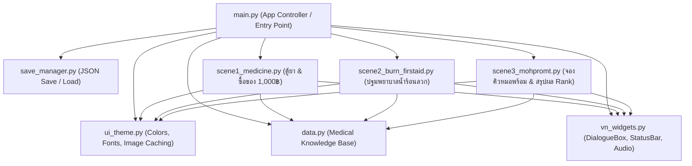

# 📖 เจาะลึกโครงสร้างโค้ด: Pharmacy Afterlife (รูมเมทตัวร้ายกับนายตู้ยา) 💊🩺
> **เอกสารอธิบายการทำงานของโค้ดอย่างละเอียด (Code Walkthrough & Architecture Guide)**  
> จัดทำขึ้นสำหรับผู้ที่กำลังศึกษาโครงสร้างการสร้างเกม **Visual Novel & Educational Mini-games** ด้วยภาษา **Python (Tkinter + Pillow)**

---

## 🗺️ 1. ภาพรวมสถาปัตยกรรมระบบ (Architecture Overview)

เกมนี้ถูกออกแบบตามแนวคิด **Data-Driven & Modular Architecture** โดยแยกส่วนการทำงานออกเป็นโมดูลชัดเจน ไม่เขียนโค้ดรวมกันในไฟล์เดียว เพื่อให้อ่านง่าย ดูแลง่าย และต่อยอดเพิ่มฉากใหม่ได้สะดวก



---

## 📂 2. อธิบายโค้ดทีละไฟล์อย่างละเอียด

---

### 1️⃣ `data.py` — ฐานข้อมูลความรู้และเนื้อหาทางการแพทย์ (Knowledge Base)
**หน้าที่:** เป็นศูนย์รวมข้อมูลทั้งหมดของเกม ทั้งข้อมูลยาสามัญประจำบ้าน อาการบาดเจ็บ และขั้นตอนการใช้บริการสาธารณสุข
* **แนวคิดสำคัญ:** **Data-Driven Design** — แยกข้อมูลออกจากโค้ด UI ทำให้เวลาต้องการแก้ไขเนื้อหา คำอธิบายยา หรือเพิ่มตัวเลือก ไม่ต้องไปยุ่งกับโค้ดส่วนแสดงผลเลย
* **ตัวแปรและโครงสร้างข้อมูลสำคัญ:**
  * `HOUSEHOLD_MEDICINES`: List ของ Dictionary เก็บข้อมูลยาสามัญประจำบ้าน 16 กลุ่มอาการ (ชื่อสามัญ, ชื่อการค้า, ข้อบ่งใช้, ขนาดวิธีใช้, คำเตือน)
  * `DRUG_STORAGE_KNOWLEDGE`: ข้อมูลและกฎเกณฑ์การจัดเก็บยาที่ถูกต้อง (เช่น การหลีกเลี่ยงแสงแดด ความชื้น และการตรวจสอบวันหมดอายุ)
  * `BURN_LEVELS`: ข้อมูลระดับความรุนแรงของแผลไฟไหม้/น้ำร้อนลวก (ระดับ 1, 2, 3) อ้างอิงมาตรฐานคณะแพทยศาสตร์ศิริราชพยาบาล
  * `FIRST_AID_QUIZ_STEPS`: ข้อมูลคำถาม-ตัวเลือกในมินิเกมปฐมพยาบาล พร้อมระบุตัวเลือกที่อันตราย (Dangerous choices เช่น การเอายาสีฟันหรือน้ำปลามาทาแผล)
  * `MOHPROM_STEPS_INFO`: ข้อมูลและคำอธิบาย 4 ขั้นตอนการจองคิวออนไลน์ผ่านแอป/Line OA หมอพร้อม (MOPH Appointment Center)

---

### 2️⃣ `ui_theme.py` — ระบบตกแต่งและตัวจัดการทรัพยากรภาพ (Design System & Assets)
**หน้าที่:** กำหนดค่าสี (Color Palette), ฟอนต์ (Typography), สไตล์ปุ่มกดแบบกำหนดเอง และระบบโหลดรูปภาพที่มีแคช
* **ส่วนประกอบสำคัญ:**
  * **Color Palette (Dark Modern Cyber-Clinic Theme):**
    * `COLOR_BG (#0b111b)`: พื้นหลังสีน้ำเงินเข้มเกือบดำ สบายตา
    * `COLOR_SURFACE (#152033)`: สีพื้นหลังของกล่อง การ์ด หรือแถบควบคุม
    * `COLOR_ACCENT (#38bdf8)`: สีฟ้าไฮไลต์ แสดงถึงความเป็นมิตรและสะอาดสะอ้าน
    * `COLOR_GREEN (#10b981)` / `COLOR_RED (#ef4444)`: สีบอกสถานะถูกต้อง/สำเร็จ และผิดพลาด/เตือนภัย
  * **Font System:** ใช้ฟอนต์มาตรฐาน `Segoe UI` ซึ่งรองรับทั้งภาษาไทยและอังกฤษได้อย่างสมบูรณ์แบบบน Windows
  * **`ImageManager` & ฟังก์ชัน `get_image()`:**
    * มีการใช้ **Dictionary Caching** เพื่อเก็บรูปที่โหลดผ่าน Pillow (`PIL.Image`, `PIL.ImageTk`) ไว้ในหน่วยความจำ
    * *ทำไมต้องทำ?* เพราะถ้าเราโหลดรูปซ้ำๆ ทุกครั้งที่เปลี่ยนฉาก โปรแกรมจะกระตุกและกิน RAM มาก การทำ Caching ช่วยให้โหลดเร็วและลื่นไหล
  * **คลาส `StyledButton(tk.Button)`:**
    * ปุ่มกด Custom ที่สืบทอดมาจาก `tk.Button` ดั้งเดิม
    * เพิ่ม Event `<Enter>` และ `<Leave>` เพื่อทำเอฟเฟกต์เปลี่ยนสีเมื่อเอาเมาส์ไปชี้ (Hover Effect) อัตโนมัติ

---

### 3️⃣ `save_manager.py` — ระบบบันทึกและโหลดสถานะเกม (Save / Load System)
**หน้าที่:** จัดการการอ่าน-เขียนไฟล์สถานะเกม (Game State) ลงในรูปแบบไฟล์ JSON รองรับการเซฟหลายช่อง (Multi-slot) และบันทึกอัตโนมัติ (Auto-save)
* **โครงสร้าง `DEFAULT_STATE`:**
  ```python
  DEFAULT_STATE = {
      "player_name": "นักศึกษาหัวร้อน",
      "score": 0,                     # คะแนนความรู้ที่สะสม
      "relationship": 50,             # ค่าความสนิทกับนายที (0-100)
      "current_scene": "scene1",      # ฉากปัจจุบัน
      "scene_step": 0,                # ขั้นตอนย่อยในฉาก
      "completed_scenes": [],         # รายการฉากที่เล่นผ่านแล้ว
      "inventory": [],                # ไอเทมยาที่ซื้อมา
      "remaining_budget": 1000,       # เงินคงเหลือจากงบ 1,000 บาท
      "playtime_notes": "...",
      "saved_at": ""
  }
  ```
* **ฟังก์ชันสำคัญ:**
  * `save_game(game_state, slot_id)`: บันทึกข้อมูลลงในโฟลเดอร์ `saves/save_{slot_id}.json` (มี slot1, slot2, slot3 และ auto)
  * `load_game(slot_id)`: อ่านไฟล์ JSON และแปลงกลับมาเป็น Python Dictionary
  * `auto_save(game_state)`: ฟังก์ชันเรียกบันทึกอัตโนมัติทุกครั้งที่ผู้เล่นจบแต่ละฉาก

---

### 4️⃣ `vn_widgets.py` — คอมโพเนนต์เฉพาะสำหรับ Visual Novel (Custom Widgets)
**หน้าที่:** รวบรวม Widget สำคัญที่ทำให้ Tkinter กลายเป็นเกม Visual Novel ที่สมบูรณ์
* **คลาส `DialogueBox(tk.Frame)` (กล่องบทสนทนา):**
  * **Typewriter Effect:** แสดงตัวอักษรทีละตัวด้วย `self.after(speed, ...)` เพื่อความลื่นไหลแบบเกม VN มืออาชีพ
  * **ระบบ Skip / Fast-Forward:** หากผู้เล่นคลิกที่กล่องข้อความขณะที่ตัวอักษรกำลังพิมพ์อยู่ จะเป็นการเร่งให้แสดงข้อความทั้งหมดทันที
  * **Choice Prompt:** สร้างปุ่มตัวเลือกตอบคำถามแบบไดนามิก รองรับการส่งฟังก์ชัน Callback เมื่อผู้เล่นเลือกคำตอบ
  * **Backlog / History:** บันทึกประวัติบทสนทนาย้อนหลัง ให้ผู้เล่นกดเปิดดูสิ่งที่คุยไปแล้วได้
* **คลาส `TopStatusBar(tk.Frame)` (แถบสถานะด้านบน):**
  * แสดงชื่อผู้เล่น, แต้มความรู้ (Score 💊), และค่าความสัมพันธ์ (Relationship 💜)
  * มีปุ่มด่วนสำหรับ **Save / Load**, **ตั้งค่าเสียง**, และ **ปุ่มเปิดโปสเตอร์ยาสามัญประจำบ้านของกระทรวงสาธารณสุข**
* **ระบบเสียง (Sound Manager):**
  * ใช้ `winsound.PlaySound()` เพื่อเล่นเสียงแป้นพิมพ์ดีด (`typewriter.wav`) และเสียงกดเปลี่ยนบทสนทนา (`advance.wav`)
  * มีการเชื่อมต่อกับ Windows API ผ่านไลบรารี `ctypes` เพื่อปรับระดับเสียงรวม (Master Volume) ของระบบได้โดยตรง

---

### 5️⃣ `scene1_medicine.py` — ฉากที่ 1: ตู้ยาปริศนาและภารกิจช้อปปิ้ง
**หน้าที่:** ควบคุมเนื้อเรื่องฉากที่ 1 และมินิเกม 2 ส่วน:
1. **มินิเกมตรวจสอบตู้ยา (Cabinet Inspection):**
   * ตรวจสอบยาในตู้ของนายที คัดแยกระหว่างยาที่ยังใช้ได้ กับยาที่เสื่อมสภาพ (เช่น ยาเปลี่ยนสี ยาตกตะกอน ยาหมดอายุ)
   * อธิบายหลักการเก็บรักษายาที่ถูกต้อง
2. **มินิเกมบริหารงบซื้อยา 1,000 บาท (Shopping Mini-game):**
   * จำลองร้านขายยา ให้ผู้เล่นเลือกซื้อยาสามัญประจำบ้านและอุปกรณ์ปฐมพยาบาลเข้าหอพัก
   * มีระบบคำนวณเงินคงเหลือแบบ Real-time และระบบตรวจสอบความจำเป็นของยา (หากซื้อของฟุ่มเฟือยหรือยาที่ไม่จำเป็น คะแนนจะไม่ผ่านเกณฑ์)

---

### 6️⃣ `scene2_burn_firstaid.py` — ฉากที่ 2: ปฐมพยาบาลแผลน้ำร้อนลวก
**หน้าที่:** ควบคุมเนื้อเรื่องฉากที่ 2 เมื่อนายทีโดนน้ำร้อนลวกขณะต้มบะหมี่กึ่งสำเร็จรูป
* **ระบบการตัดสินใจทีละขั้นตอน (Step-by-step Decision Tree):**
  * ผู้เล่นต้องประเมินระดับความรุนแรงของแผล (Grade 1 vs Grade 2)
  * ลำดับขั้นตอนการปฐมพยาบาลที่ถูกต้อง:
    1. ล้างด้วยน้ำสะอาดอุณหภูมิห้องทันทีอย่างน้อย 10-15 นาที (ห้ามใช้น้ำแข็งประคบโดยตรง)
    2. ซับให้แห้งอย่างเบามือด้วยผ้าสะอาด
    3. ปิดแผลด้วยผ้าก๊อซสะอาดหรือพลาสติกแรปใส
* **ระบบตรวจสอบความปลอดภัย (Danger Penalty & Game Over):**
  * หากผู้เล่นเลือกความเชื่อผิดๆ เช่น **"เอายาสีฟันมาทา"** หรือ **"เอาน้ำปลา/น้ำมันพืชราด"** ระบบจะหักคะแนนอย่างหนัก พร้อมขึ้นคำเตือนสีแดงอธิบายอันตรายของการติดเชื้อ
  * หากเลือกวิธีอันตรายซ้ำเกิน 2 ครั้ง จะนำไปสู่ฉาก **Game Over** ทันที เพื่อเน้นย้ำความสำคัญของการปฐมพยาบาลที่ถูกต้อง

---

### 7️⃣ `scene3_mohpromt.py` — ฉากที่ 3: จองคิวหมอพร้อม & สรุปผลตอนจบ (Ending)
**หน้าที่:** ให้ความรู้เรื่องระบบบริการสุขภาพดิจิทัล และสรุปผลการเล่น
* **มินิเกมจำลองสมาร์ทโฟน (Interactive Phone Simulator):**
  * จำลองหน้าจอสมาร์ทโฟนของแอป **"หมอพร้อม" (MOPH Appointment Center)**
  * นำทางผู้เล่นผ่าน 4 ขั้นตอน:
    1. เลือกสถานพยาบาลใกล้บ้าน
    2. เลือกแผนกตรวจรักษา
    3. เลือกวันและช่วงเวลาที่สะดวก
    4. ตรวจสอบข้อมูล ยืนยัน และรับใบนัดหมายดิจิทัลพร้อม QR Code
* **ระบบคำนวณและประเมินผลตอนจบ (Ending Evaluation):**
  * คำนวณจาก `score` (คะแนนความรู้) + `relationship` (ความสัมพันธ์กับที)
  * **Rank S (ผู้พิทักษ์แห่งหอพัก):** คะแนนยอดเยี่ยม ได้รับฉายาและบทสนทนาจบที่ดีที่สุด
  * **Rank A (เพื่อนแท้สายสุขภาพ):** ผ่านเกณฑ์ในระดับดีมาก
  * **Rank B / C (เมทผู้รอดชีวิตแบบหวุดหวิด):** มีข้อผิดพลาดบางจุด แต่ยังพานายทีรอดมาได้

---

### 8️⃣ `main.py` — จุดเริ่มต้นและตัวควบคุมหน้าจอหลัก (Main Controller)
**หน้าที่:** หน้าต่างโปรแกรมหลัก (`PharmacyAfterlifeApp`), รับผิดชอบการสลับหน้าจอ (Screen Switching), เมนูหลัก, และการจัดการปุ่มคีย์บอร์ด
* **เทคนิค Frame Switching ใน Tkinter:**
  * ใช้เทคนิคการสร้าง Container กลาง (`self.container = tk.Frame(...)`)
  * เวลาจะเปิดหน้าไหน จะใช้คำสั่ง `.pack(fill="both", expand=True)` และซ่อนหน้าเดิมด้วย `.pack_forget()`
  * ช่วยให้สลับระหว่าง **หน้าแรก (Main Menu) -> ฉากในเกม (Scenes) -> คู่มือยา (Handbook) -> ตั้งค่า (Options)** ได้อย่างราบรื่นโดยไม่ต้องเปิดหน้าต่างใหม่ (No multiple windows)
* **Context-Aware Keyboard Navigation:**
  * ผูกคีย์ `<Escape>` เพื่อให้กดแล้วย้อนกลับเมนูก่อนหน้า หรือเปิดหน้าต่างยืนยันการออกจากเกมอย่างปลอดภัย

---

## 💡 3. ความรู้และเทคนิค Python/Tkinter ที่มือใหม่ควรรู้จากโปรเจกต์นี้

### 1. ทำไมถึงห้ามใช้ `time.sleep()` ใน Tkinter?
ใน Tkinter หากเราใช้ `time.sleep(1)` หน้าต่างโปรแกรมจะ **ค้าง (Freeze)** ทันที เพราะมันไปหยุดการทำงานของ Main Event Loop (`root.mainloop()`)  
👉 **วิธีที่ถูกต้อง:** ใช้ `widget.after(milliseconds, callback_function)` แทน เพื่อให้ระบบทำงานตามเวลาที่กำหนดโดยที่หน้าต่างยังคงตอบสนองการคลิกเมาส์ได้ปกติ (ดูตัวอย่างใน `DialogueBox.type_next_char`)

### 2. การใช้ Callback Functions ในการเปลี่ยนผ่านฉาก
แต่ละฉาก (Scene Frame) จะไม่รู้ว่าฉากต่อไปคืออะไร แต่จะรับพารามิเตอร์ `on_finish` เข้ามา:
```python
# เมื่อ Scene 1 เล่นจบ จะเรียกฟังก์ชันนี้เพื่อส่งไม้ต่อให้ Scene 2
self.current_scene_frame = Scene1MedicineFrame(
    self.container, 
    self.game_state, 
    on_finish=self.start_scene2
)
```
เทคนิคนี้เรียกว่า **Inversion of Control (IoC)** ทำให้โค้ดแต่ละฉากเป็นอิสระต่อกัน (Decoupled) สามารถหยิบไปสลับลำดับหรือทดสอบแยกเดี่ยวได้ง่าย

### 3. การเก็บรูปภาพไม่ให้หาย (Garbage Collection in Tkinter)
ใน Tkinter ถ้าเราสร้าง `ImageTk.PhotoImage` ไว้ในฟังก์ชันธรรมดา เมื่อฟังก์ชันทำงานจบ Python จะลบรูปนั้นทิ้ง ทำให้รูปไม่แสดงบนหน้าจอ  
👉 **วิธีแก้:** ต้องผูกรูปเก็บไว้ใน Attribute ของ Widget เสมอ เช่น `label.image = photo` (ดูตัวอย่างใน `ui_theme.py`)

---

## 🛠️ 4. แนวทางการนำไปต่อยอด (How to Extend)
* **เพิ่มฉากใหม่ (Scene 4):** สร้างไฟล์ `scene4_xxx.py` โดยสืบทอดจาก `tk.Frame` รับ `game_state` และ `on_finish` เหมือนตัวอย่างใน `scene1_medicine.py`
* **เพิ่มข้อมูลยา:** เปิดไฟล์ `data.py` แล้วเพิ่มข้อมูลเข้าไปใน List `HOUSEHOLD_MEDICINES` ได้ทันที หน้าต่าง Handbook ในเกมจะดึงข้อมูลไปแสดงผลอัตโนมัติ
* **เปลี่ยนภาพหรือเสียง:** เพียงนำไฟล์ `.png`, `.jpg` หรือ `.wav` มาวางทับในโฟลเดอร์ `assets/` โดยตั้งชื่อเดิม
