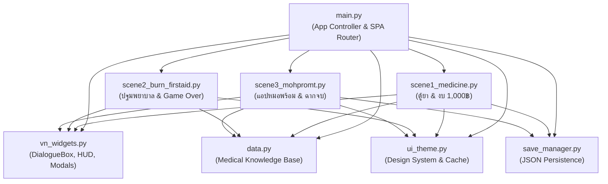

# 🎓 คู่มือเตรียมพรีเซนต์และตอบคำถามอาจารย์อย่างมืออาชีพ
## โครงงาน: Pharmacy Afterlife (รูมเมทตัวร้ายกับนายตู้ยา — Stay Alive, Tee!)
> **เอกสารวิเคราะห์สถาปัตยกรรมและการทำงานของซอร์สโค้ดฉบับสมบูรณ์ (Comprehensive Technical Defense Guide)**  
> จัดทำขึ้นสำหรับนักศึกษาเพื่อใช้ศึกษา ทบทวน ลำดับความคิด เตรียมสไลด์พรีเซนต์ และตอบคำถามคณะกรรมการสอบโครงงาน/อาจารย์ผู้สอน

---

## 📑 สารบัญ (Table of Contents)
1. [ภาพรวมของโปรแกรม (System Overview & Core Philosophy)](#1-ภาพรวมของโปรแกรม-system-overview--core-philosophy)
2. [สถาปัตยกรรมและการเชื่อมโยงข้อมูล (Architecture & Data Flow)](#2-สถาปัตยกรรมและการเชื่อมโยงข้อมูล-architecture--data-flow)
3. [การเจาะลึกโค้ดทีละโมดูล / ทีละบล็อกสำคัญ (Block-by-Block Code Deep Dive)](#3-การเจาะลึกโค้ดทีละโมดูล--ทีละบล็อกสำคัญ-block-by-block-code-deep-dive)
   - [3.1 main.py — App Controller & Single Page Routing](#31-mainpy--app-controller--single-page-routing)
   - [3.2 ui_theme.py — Design System, Custom Button & Image Caching](#32-ui_themepy--design-system-custom-button--image-caching)
   - [3.3 data.py — Data-Driven Medical Knowledge Base](#33-datapy--data-driven-medical-knowledge-base)
   - [3.4 save_manager.py — State Persistence & Defensive JSON Serialization](#34-save_managerpy--state-persistence--defensive-json-serialization)
   - [3.5 vn_widgets.py — Visual Novel Engine, Typewriter & HUD](#35-vn_widgetspy--visual-novel-engine-typewriter--hud)
   - [3.6 scene1_medicine.py — ตรวจสอบยา & มินิเกมช้อปปิ้ง 1,000 บาท](#36-scene1_medicinepy--ตรวจสอบยา--มินิเกมช้อปปิ้ง-1000-บาท)
   - [3.7 scene2_burn_firstaid.py — ปฐมพยาบาลน้ำร้อนลวก & 3-Strikes Game Over](#37-scene2_burn_firstaidpy--ปฐมพยาบาลน้ำร้อนลวก--3-strikes-game-over)
   - [3.8 scene3_mohpromt.py — จำลองสมาร์ทโฟนหมอพร้อม & Evaluation Engine](#38-scene3_mohpromtpy--จำลองสมาร์ทโฟนหมอพร้อม--evaluation-engine)
4. [แนวทางการประยุกต์ใช้งานในชีวิตจริง (Practical Applications)](#4-แนวทางการประยุกต์ใช้งานในชีวิตจริง-practical-applications)
5. [10 คำถามเด็ดที่อาจารย์มักจะถาม พร้อมแนวทางการตอบ (Potential Q&A)](#5-10-คำถามเด็ดที่อาจารย์มักจะถาม-พร้อมแนวทางการตอบ-potential-qa)

---

## 1. ภาพรวมของโปรแกรม (System Overview & Core Philosophy)

### 1.1 ที่มาและปัญหาที่ต้องการแก้ไข (Problem Statement)
ในชีวิตประจำวันของนักศึกษาและประชาชนทั่วไป มักพบปัญหาสำคัญด้านสุขภาพ 3 ประการ:
1. **การใช้ยาผิดประเภทและการเก็บรักษาไม่ถูกต้อง:** การรับประทานยาที่เสื่อมสภาพ (ยาเม็ดแตกร่วน, ยาน้ำตกตะกอน), การไม่ทราบชื่อสามัญทางยา (Generic Name) กับชื่อทางการค้า (Brand Name), และการขาดแคลนยาสามัญประจำบ้านขั้นพื้นฐาน
2. **ความเชื่อผิดๆ ในการปฐมพยาบาล:** เมื่อเกิดอุบัติเหตุน้ำร้อนลวก มักมีการนำยาสีฟัน, น้ำปลา, หรือน้ำแข็งมาประคบโดยตรง ซึ่งเพิ่มอัตราการติดเชื้อรุนแรงและทำให้เนื้อเยื่อตายเพิ่มขึ้น
3. **ความไม่คุ้นชินกับระบบบริการสาธารณสุขดิจิทัล:** การเดินทางไปโรงพยาบาลโดยไม่ได้นัดหมายล่วงหน้า ทำให้เกิดความแออัดและเสียเวลารอคอยนาน ทั้งที่ระบบของกระทรวงสาธารณสุข (MOPH Appointment Center / แอปหมอพร้อม) มีระบบจองคิวออนไลน์รองรับ

### 1.2 โซลูชันและการออกแบบ (Solution & Design)
โครงงานนี้พัฒนา **Educational Serious Game (เกมสาระประโยชน์)** ในรูปแบบ **Interactive Visual Novel ผสม Mini-games** โดยผู้เล่นจะสวมบทบาทเป็นตัวละครที่ต้องดูแล "ที" รูมเมทเด็กสถาปัตย์จอมมึนที่พักผ่อนน้อย เพื่อให้การเรียนรู้เรื่องยาและการปฐมพยาบาลมีความสนุก น่าติดตาม และเกิดการจดจำผ่านการลงมือทำจริง (Gamification)

### 1.3 Tech Stack & Technology Decisions
* **ภาษาหลัก:** Python 3.10+
* **GUI Framework:** Tkinter (Standard GUI Library ของ Python)
* **Image Processing & Asset Resampling:** Pillow (PIL)
* **Audio Subsystem:** Winsound (Standard Windows Audio) ผสาน Windows API (`ctypes.windll.winmm`) สำหรับ Master Volume Control
* **Data Serialization:** JSON (JavaScript Object Notation)

---

## 2. สถาปัตยกรรมและการเชื่อมโยงข้อมูล (Architecture & Data Flow)

โปรเจกต์นี้ได้รับการออกแบบโดยใช้หลักการ **Separation of Concerns (SoC)**, **Data-Driven Design**, และ **Component-Based Architecture**:



### 2.1 State Management (วัฏจักรข้อมูลและการไหลของ State)
ตัวแปรสถานะของทั้งเกมถูกจัดเก็บอยู่ในรูปแบบ Python Dictionary (`self.game_state`) ภายใน `main.py` โดยมีโครงสร้างข้อมูลดังนี้:
```python
game_state = {
    "player_name": "กราฟ",         # ชื่อผู้เล่น (ระบุตอนเริ่มเกมใหม่หรือแก้ใน Options)
    "score": 0,                    # แต้มความรู้ทางการแพทย์สะสม (ส่งผลต่อ Rank)
    "relationship": 50,            # แต้มความสนิทกับนายที (0-100)
    "current_scene": "scene1",     # ฉากปัจจุบันที่กำลังเล่นอยู่
    "scene_step": 0,               # ขั้นตอนย่อยในแต่ละฉาก
    "completed_scenes": [],        # รายการฉากที่เล่นจบสมบูรณ์แล้ว
    "inventory": [],               # รายการยาและของใช้ที่ซื้อมา
    "remaining_budget": 1000,      # เงินคงเหลือจากงบ 1,000 บาท
    "saved_at": ""                 # เวลาที่ทำการบันทึกล่าสุด
}
```

### 2.2 การเปลี่ยนผ่านฉากด้วย Inversion of Control (IoC Callbacks)
แทนที่ฉากหนึ่งจะ Import ฉากถัดไปโดยตรง (ซึ่งจะทำให้เกิด Circular Dependency และ High Coupling) โปรแกรมจะส่ง **Callback Function** จาก `main.py` เข้าไปในแต่ละฉาก:
```python
# ตัวอย่างใน main.py
self.current_scene_frame = Scene1MedicineFrame(
    self.container, 
    self.game_state,
    on_finish_scene=lambda: self.load_scene("scene2"),
    on_exit_to_menu=self.return_to_menu
)
```
เมื่อ Scene 1 ทำงานจบ จะสั่งรัน `self.on_finish_scene()` ส่งผลให้ `main.py` ทำลาย Frame เก่าทิ้ง และสร้าง `Scene2BurnFirstAidFrame` ขึ้นมาแทนที่อย่างเป็นอิสระ

---

## 3. การเจาะลึกโค้ดทีละโมดูล / ทีละบล็อกสำคัญ (Block-by-Block Code Deep Dive)

---

### 3.1 `main.py` — App Controller & Single Page Routing
ทำหน้าที่เป็น Entry Point และศูนย์กลางควบคุมการแสดงผลของทั้งโปรแกรม

#### บล็อกที่ 1: การกำหนดค่าเริ่มต้นใน `PharmacyAfterlifeApp.__init__(self, root)`
```python
self.root = root
self.root.title("Stay Alive, Tee!: เมทข้าต้องรอด!")
self.root.geometry("1024x720")
self.root.minsize(1000, 680)
self.root.configure(bg=COLOR_BG)
```
* **คำอธิบาย:** กำหนดขนาดหน้าต่างเริ่มต้นที่ 1024x720 พิกเซล และล็อกขนาดต่ำสุดที่ 1000x680 เพื่อป้องกันปุ่มและ Layout ตกขอบ
* **`self.container = tk.Frame(...)`:** สร้าง Container หลักสำหรับบรรจุหน้าจอต่างๆ แบบ Single Page Application (SPA)

#### บล็อกที่ 2: ระบบ Context-Aware Escape Handler (`handle_escape_key`)
```python
def handle_escape_key(self, event=None):
    # 1. ปิดหน้าต่าง Toplevel หรือ Popup ที่เปิดอยู่ด้านบนสุดก่อน
    toplevels = [w for w in self.root.winfo_children() if isinstance(w, tk.Toplevel) and w.winfo_exists()]
    if toplevels:
        top = toplevels[-1]
        top.grab_release()
        top.destroy()
        return "break"
    # 2. ถ้าอยู่ในหน้า Options หรือ Credits ให้ย้อนกลับสู่เมนูหลัก
    if cur_frame in [self.options_frame, self.credits_frame]:
        self.show_page(self.menu_frame)
        return "break"
    # 3. ถ้ากำลังเล่นฉากในเกม ให้ถามยืนยันพร้อม Auto-Save
    if self.current_scene_frame and cur_frame == self.current_scene_frame:
        if messagebox.askyesno("กลับสู่เมนูหลัก", "คุณต้องการหยุดพักและกลับสู่หน้าเมนูหลักหรือไม่?\n(ระบบจะทำการบันทึกเกมอัตโนมัติ)"):
            save_manager.save_game(self.game_state, "auto")
            self.return_to_menu()
        return "break"
    # 4. หากอยู่ที่หน้าเมนูหลักอยู่แล้ว ให้ถามยืนยันออกจากโปรแกรม
    self.confirm_exit()
    return "break"
```
* **จุดเด่น:** ประเมินบริบทของผู้เล่นว่าอยู่ที่ไหน ไม่ปิดโปรแกรมทิ้งทันที แต่ทำงานเป็นลำดับชั้น (Modal -> Subpage -> Scene with Auto-Save -> App Exit)

#### บล็อกที่ 3: ระบบสลับฉากแบบ Zero-Flicker (`load_scene`)
```python
def load_scene(self, scene_name):
    if self.current_scene_frame:
        self.current_scene_frame.destroy()
        self.current_scene_frame = None

    if scene_name == "scene1":
        self.current_scene_frame = Scene1MedicineFrame(
            self.container, self.game_state,
            on_finish_scene=lambda: self.load_scene("scene2"),
            on_exit_to_menu=self.return_to_menu
        )
    ...
    self.current_scene_frame.place(x=0, y=0, relwidth=1, relheight=1)
    self.current_scene_frame.tkraise()
```
* **คำอธิบาย:** สั่งทำลาย (`destroy()`) Widget ของฉากเก่าทิ้งทันที เพื่อคืนหน่วยความจำ (RAM) ให้ระบบ จากนั้น Instantiate Class ของฉากใหม่ และใช้ `.place()` เต็มพื้นที่ Container

---

### 3.2 `ui_theme.py` — Design System, Custom Button & Image Caching
เป็นศูนย์รวมการตั้งค่าความสวยงามและทรัพยากรภาพ

#### บล็อกที่ 1: การแคชรูปภาพ (In-Memory Image Caching) ใน `get_image`
```python
_image_cache = {}

def get_image(filename, size=None):
    key = (filename, size)
    if key in _image_cache:
        return _image_cache[key]
    ...
    pil_img = Image.open(target_path)
    if size:
        pil_img = pil_img.resize(size, Image.Resampling.LANCZOS)
    tk_img = ImageTk.PhotoImage(pil_img)
    _image_cache[key] = tk_img
    return tk_img
```
* **ทำไมต้องทำ Caching?** หากไม่มี Dict `_image_cache` โปรแกรมจะต้องอ่านไฟล์จาก Hard Disk และใช้ CPU ประมวลผล Resize รูปภาพทุกครั้งที่เฟรมถูกเรนเดอร์ใหม่ ซึ่งจะทำให้โปรแกรมกระตุก (Lag)
* **`Image.Resampling.LANCZOS`:** ใช้อัลกอริทึม Lanczos ซึ่งเป็นฟิลเตอร์ลดรอยหยักคุณภาพสูงสุดของ Pillow ทำให้ภาพคมชัดแม้ถูกย่อขนาดลงมาก
* **PNG Transparency Fallback:** หากเรียกไฟล์ `.jpg` แต่มี `.png` ที่เป็นภาพตัดพื้นหลังโปร่งใส ฟังก์ชันจะสลับไปโหลด `.png` ให้ก่อนอัตโนมัติ

#### บล็อกที่ 2: วิดเจ็ตปุ่มคัสตอม `StyledButton(tk.Button)`
```python
class StyledButton(tk.Button):
    def __init__(self, parent, text, command=None, ...):
        super().__init__(parent, **btn_kwargs)
        self.bind("<Enter>", self.on_enter)
        self.bind("<Leave>", self.on_leave)
        self.bind("<Return>", self.on_key_activate)
        self.bind("<space>", self.on_key_activate)
```
* **คำอธิบาย:** สืบทอดคุณสมบัติมาจาก `tk.Button` ดั้งเดิม แล้วผูก Event `<Enter>` และ `<Leave>` เพื่อเปลี่ยนสีพื้นหลังและตัวอักษรเมื่อเอาเมาส์ไปชี้ (Hover Effect) พร้อมรองรับคีย์บอร์ดกดปุ่ม Enter หรือ Spacebar เพื่อสั่งงาน

---

### 3.3 `data.py` — Data-Driven Medical Knowledge Base
ศูนย์รวมความรู้ทางการแพทย์ทั้งหมด แยกข้อมูลออกจากโค้ด Logic ตามหลัก **Data-Driven Architecture**

* **`HOUSEHOLD_MEDICINES`:** รายการยาสามัญประจำบ้าน 16 กลุ่มอาการ อ้างอิงประกาศกระทรวงสาธารณสุขและ พ.ร.บ. ยา ระบุชื่อสามัญ, ชื่อการค้า 2 แบรนด์, ขนาดวิธีใช้ และข้อควรระวัง
* **`MOPH_HOUSEHOLD_CATEGORIES`:** ยาสามัญประจำบ้าน 11 กลุ่มที่จำหน่ายได้ในร้านชำ อ้างอิงไฟล์เอกสารทางการ `long.pdf` ของกลุ่มงานคุ้มครองผู้บริโภคและเภสัชสาธารณสุข
* **`DRUG_STORAGE_KNOWLEDGE`:** กฎเกณฑ์การตรวจสอบยาเสื่อมคุณภาพ (ยาเม็ดแตกร่วน, ยาแคปซูลนิ่มเหนียว, ยาน้ำแยกชั้นตกตะกอน)
* **`BURN_LEVELS` & `FIRST_AID_QUIZ_STEPS`:** องค์ความรู้การประเมินแผลไฟไหม้/น้ำร้อนลวกระดับที่ 1, 2, 3 และลำดับขั้นตอนการปฐมพยาบาล อ้างอิงมาตรฐานโรงพยาบาลศิริราช
* **`SHOP_ITEMS`:** รายการสินค้า 16 ชนิดในร้านค้า พร้อมกำหนดราคา, กลุ่มยา, และแท็ก `is_essential: True/False` สำหรับมินิเกมบริหารงบประมาณ 1,000 บาท

---

### 3.4 `save_manager.py` — State Persistence & Defensive JSON Serialization
รับผิดชอบการอ่านและเขียนไฟล์สถานะเกมลง Hard Disk

#### บล็อกสำคัญ: การบันทึกและโหลดอย่างปลอดภัย (Defensive Merging)
```python
def load_game(slot_id="slot1"):
    filepath = get_slot_path(slot_id)
    if not os.path.exists(filepath):
        return None
    with open(filepath, "r", encoding="utf-8") as f:
        data = json.load(f)
        merged = DEFAULT_STATE.copy()
        merged.update(data)
        return merged
```
* **จุดเด่นทางเทคนิค:** ใช้เทคนิค `merged = DEFAULT_STATE.copy(); merged.update(data)` เพื่อป้องกันข้อผิดพลาดประเภท `KeyError` ในกรณีที่ผู้เล่นโหลดไฟล์เซฟเก่าที่อาจไม่มีคีย์ใหม่ที่เพิ่งเพิ่มเข้ามาในระบบ

---

### 3.5 `vn_widgets.py` — Visual Novel Engine, Typewriter & HUD
โมดูลขับเคลื่อนหลักของความเป็นเกม Visual Novel

#### บล็อกที่ 1: Typewriter Effect แบบ Non-blocking ใน `DialogueBox`
```python
def _type_step(self):
    if self._char_index < len(self._full_text):
        self._char_index += 1
        self.lbl_text.config(text=self._full_text[:self._char_index])
        
        # เล่นเสียงเคาะแป้นพิมพ์ทุกๆ 2 ตัวอักษร
        cur_char = self._full_text[self._char_index - 1]
        if self._char_index % 2 == 0 and cur_char not in (" ", "\n", "\t"):
            play_sfx(TYPEWRITER_SOUND)
            
        self._type_after_id = self.after(self._type_speed_ms, self._type_step)
    else:
        self._is_typing = False
        self.lbl_indicator.config(fg=COLOR_ACCENT)
```
* **ทำไมไม่ใช้ `time.sleep()`?** ใน Tkinter หากเรียก `time.sleep()` จะทำให้ Main Event Loop หยุดทำงาน ส่งผลให้หน้าต่างโปรแกรมค้าง (Not Responding) และคลิกอะไรไม่ได้เลย  
  👉 **ทางแก้:** ต้องใช้ `self.after(ms, callback)` เพื่อส่งคำสั่งเข้าคิวประมวลผลตามเวลา โดยที่ GUI ยังคงรับ Event จากเมาส์และคีย์บอร์ดได้ตลอดเวลา

#### บล็อกที่ 2: ระบบเสียง Asynchronous (`play_sfx`)
```python
def play_sfx(sound_path):
    if not _sound_enabled:
        return
    winsound.PlaySound(sound_path, winsound.SND_FILENAME | winsound.SND_ASYNC)
```
* **`winsound.SND_ASYNC`:** เป็น Flag สำคัญที่บอกให้ระบบปฏิบัติการเล่นเสียงใน Background Thread ทำให้การเล่นเสียงคลิกหรือเสียงพิมพ์ดีดไม่ไปชะลอการวาดหน้าจอ GUI

---

### 3.6 `scene1_medicine.py` — ตรวจสอบยา & มินิเกมช้อปปิ้ง 1,000 บาท
ประกอบด้วย 2 ระบบเกมย่อย:
1. **Cabinet Inspection Minigame:** ผู้เล่นต้องคลิกสำรวจยาในตู้ของที แล้ววินิจฉัยแยกระหว่าง "ยาหมดอายุ/เสื่อมสภาพ (ต้องทิ้ง)" กับ "ยาที่ยังใช้ได้"
2. **Shopping Minigame (งบประมาณ 1,000 บาท):**
   - ผู้เล่นต้องเลือกซื้อยาจำเป็นเข้าหอพัก
   - **อัลกอริทึมตรวจสอบตะกร้าสินค้า (`handle_checkout`):**
     ```python
     # ตรวจสอบกลุ่มยาจำเป็น 7 กลุ่ม
     missing_needed = []
     for cat_code, cat_info in NEEDED_MED_GROUPS.items():
         has_item = any(item_id in self.shopping_cart for item_id in cat_info["items"])
         if not has_item:
             missing_needed.append(cat_info["name"])
     ```
   - **Consequences:** หากซื้อไม่ครบ 7 กลุ่ม หรือเงินหมดก่อน จะตัดเข้าฉาก **Bad Ending** (ทีเกิดอาการป่วยฉุกเฉินตอนดึกแต่ไม่มียากิน) พร้อมอธิบายสาเหตุและให้โอกาสกลับมาเลือกซื้อใหม่

---

### 3.7 `scene2_burn_firstaid.py` — ปฐมพยาบาลน้ำร้อนลวก & 3-Strikes Game Over
จำลองสถานการณ์อุบัติเหตุทีทำน้ำร้อนลวกขณะต้มบะหมี่กึ่งสำเร็จรูป

* **Decision Tree ตามมาตรฐาน รพ.ศิริราช:**
  1. ประเมินระดับแผล (แผลระดับที่ 2 ชนิดตื้น มีตุ่มน้ำพองใส)
  2. ล้างด้วยน้ำสะอาดอุณหภูมิห้อง 10-15 นาที (ห้ามใช้น้ำแข็งหรือน้ำเย็นจัด)
  3. ห้ามเจาะตุ่มน้ำพองใสเด็ดขาด
  4. ปิดแผลหลวมๆ ด้วยผ้าก๊อซสะอาด
* **ระบบความปลอดภัย (3-Strikes Game Over Engine):**
  - หากผู้เล่นเลือกความเชื่อผิดๆ เช่น **"ทายาสีฟัน"**, **"ราดน้ำปลา"**, หรือ **"ประคบน้ำแข็งโดยตรง"**
  - ตัวนับความผิดพลาดจะเพิ่มขึ้น `self.mistakes_count += 1` และหักคะแนน `score -= 5`
  - หากเลือกวิธีอันตรายครบ 3 ครั้ง จะตัดเข้าสู่หน้าจอ **GAME OVER** แสดงบทวิเคราะห์ข้อผิดพลาด และบังคับให้ผู้เล่นเริ่มฝึกปฐมพยาบาลใหม่ตั้งแต่ต้น

---

### 3.8 `scene3_mohpromt.py` — จำลองสมาร์ทโฟนหมอพร้อม & Evaluation Engine
ประกอบด้วยการจำลองแอปพลิเคชันมือถือเสมือนจริง 4 ขั้นตอน:
1. **หน้าบริการ:** เลือก "นัดหมายออนไลน์"
2. **เมนูย่อย:** เลือก "จองคิวหมอ"
3. **ฟอร์มระบุข้อมูลนัดหมาย:** จังหวัด, โรงพยาบาล, แผนก, วันที่, แพทย์, เวลา และระบุอาการ
4. **ใบนัดหมายดิจิทัล:** แสดงบัตรนัดเสมือนจริงพร้อม QR Code

#### ระบบประเมินผลตอนจบ (Rank Evaluation Engine)
```python
rel = self.game_state["relationship"]
if rel >= 85:
    rank_title = "🌟 ระดับ S: สุดยอดคู่หูรูมเมทตลอดกาล"
elif rel >= 65:
    rank_title = "⭐ ระดับ A: สหายร่วมรบผ่านศึกมหาลัย"
else:
    rank_title = "🌱 ระดับ B: รูมเมทคู่กัดสุดป่วน"
```
* นำค่า `score` (ความถูกต้องด้านความรู้) และ `relationship` (การตอบสนองความรู้สึกกับเพื่อน) มาคำนวณบทสรุปและฉายาตอนจบ

---

## 4. แนวทางการประยุกต์ใช้งานในชีวิตจริง (Practical Applications)

1. **สื่อการเรียนการสอนสุขศึกษาและวิทยาศาสตร์สุขภาพ (EdTech / Health Literacy):**
   - สามารถนำไปใช้เป็นแบบเรียนจำลองสถานการณ์ในโรงเรียนระดับมัธยมหรือมหาวิทยาลัย เพื่อให้นักศึกษาได้ทดลองปฏิบัติก่อนเผชิญสถานการณ์จริง
2. **ระบบฝึกอบรมและปฐมนิเทศพนักงานใหม่ (Corporate Training Simulator):**
   - สถาปัตยกรรม Visual Novel + Decision Tree สามารถนำไปปรับเนื้อหาเป็น "การอบรมความปลอดภัยในโรงงาน (Safety First)" หรือ "การปฐมพยาบาลเบื้องต้นในออฟฟิศ"
3. **ต้นแบบระบบจำลองบริการสาธารณสุขดิจิทัล (Digital Health Simulator):**
   - โมดูลใน `scene3_mohpromt.py` เป็นตัวอย่างการทำ Interactive Prototype เพื่อสอนผู้สูงอายุหรือประชาชนทั่วไปให้คุ้นเคยกับการจองคิวออนไลน์ก่อนใช้งานแอปจริงของภาครัฐ
4. **Game Engine Template สำหรับเกมแนว 2D Narrative บน Python:**
   - โค้ดส่วน `vn_widgets.py`, `ui_theme.py`, และ `save_manager.py` สามารถหยิบไปใช้เป็น Framework พื้นฐานในการสร้างเกม Visual Novel หัวข้ออื่นๆ ได้ทันทีโดยไม่ต้องเขียน GUI ใหม่

---

## 5. 10 คำถามเด็ดที่อาจารย์มักจะถาม พร้อมแนวทางการตอบ (Potential Q&A)

### Q1: ทำไมถึงเลือกใช้ Tkinter พัฒนาเกม ทำไมไม่ใช้ Pygame หรือ Unity?
> **แนวทางการตอบ:**  
> "เหตุผลหลักคือ **Portability และ Zero External Dependencies** ครับ เนื่องจาก Tkinter เป็นไลบรารีมาตรฐานที่ติดตั้งมาพร้อมกับ Python อยู่แล้ว ทำให้ผู้ใช้งานสามารถดาวน์โหลดโปรแกรมไปเปิดรันได้ทันทีโดยไม่ต้องติดตั้งไดรเวอร์กราฟิกขนาดใหญ่ นอกจากนี้ โครงสร้างของเกมเราเน้นไปที่ระบบ UI, กล่องข้อความ, ปุ่มตัวเลือก, ฟอร์มกรอกข้อมูล และมินิเกมจำลองสมาร์ทโฟน ซึ่งการใช้ UI Framework ที่เป็น Widget-Based อย่าง Tkinter มีความเหมาะสมกับการจัดการ Layout ข้อความและฟอร์มมากกว่า Game Engine แบบ Loop-Based อย่าง Pygame ครับ"

---

### Q2: ในระบบข้อความพิมพ์ดีด (Typewriter Effect) ทำไมถึงห้ามใช้ `time.sleep()`?
> **แนวทางการตอบ:**  
> "เพราะ Tkinter ทำงานอยู่บน **Single Thread Main Event Loop (`root.mainloop()`)** ครับ ถ้าเราสั่ง `time.sleep()` จะส่งผลให้ Thread หลักถูกบล็อก หน้าต่างโปรแกรมจะไม่สามารถดักจับการคลิกเมาส์ การกดคีย์บอร์ด หรือการวาดภาพใหม่ได้เลย เกิดอาการหน้าจอค้าง (Not Responding)  
> ในโปรเจกต์นี้จึงใช้ `self.after(delay_ms, callback)` แทน ซึ่งเป็นกลไกของ Tkinter Event Scheduler ที่ส่งงานเข้าคิวประมวลผลตามเวลา ทำให้ระบบสามารถพิมพ์ข้อความไปพร้อมๆ กับที่ผู้เล่นยังสามารถคลิกข้าม (Skip) หรือกดปุ่มอื่นได้ตลอดเวลาครับ"

---

### Q3: ปัญหา Image Garbage Collection ใน Tkinter คืออะไร และในโค้ดแก้ไขอย่างไร?
> **แนวทางการตอบ:**  
> "ใน Tkinter เมื่อเราโหลดภาพด้วย `ImageTk.PhotoImage` ภายในฟังก์ชัน ตัว Python Garbage Collector จะมองว่าอ็อบเจกต์ภาพนั้นไม่มีตัวแปรอ้างอิงหลังจากฟังก์ชันทำงานเสร็จ และจะลบภาพนั้นทิ้งจากหน่วยความจำ ส่งผลให้รูปกลายเป็นพื้นที่ว่างสีขาวหรือไม่แสดงบนหน้าจอ  
> วิธีแก้ในโปรเจกต์นี้มี 2 ส่วนครับ:
> 1. ใน `ui_theme.py` เราสร้าง Dictionary `_image_cache` เก็บภาพไว้ที่ระดับ Global Module
> 2. ในทุก Widget ที่แสดงภาพ เราจะผูกตัวแปรเก็บไว้ในแอตทริบิวต์ของวิดเจ็ตเสมอ เช่น `label.image = photo` เพื่อให้มี Reference อยู่ตลอดเวลาครับ"

---

### Q4: สถาปัตยกรรมแบบ Data-Driven ใน `data.py` มีประโยชน์อย่างไรในมุมมองวิศวกรรมซอฟต์แวร์?
> **แนวทางการตอบ:**  
> "ช่วยเรื่อง **Separation of Concerns (SoC) และ Maintainability** ครับ ทำให้ข้อมูลทางการแพทย์ เช่น รายการยาสามัญประจำบ้าน 16 กลุ่ม, ตัวเลือกคำถามปฐมพยาบาล, และข้อมูลโรงพยาบาล ถูกแยกขาดออกจากโค้ดส่วนแสดงผล UI  
> หากในอนาคตกระทรวงสาธารณสุขมีการอัปเดตกฎหมายยาใหม่ หรือต้องการเพิ่มคำถามควิซ เราสามารถแก้ไขหรือเพิ่ม Dictionary ใน `data.py` ได้ทันที โดยไม่ต้องแตะต้องหรือเสี่ยงทำให้โค้ดส่วนเรนเดอร์หน้าจอพังครับ"

---

### Q5: การสลับหน้าจอ (Screen Switching) ในเกมนี้มีปัญหา Memory Leak หรือไม่ จัดการอย่างไร?
> **แนวทางการตอบ:**  
> "ไม่มีปัญหา Memory Leak ครับ เพราะในฟังก์ชัน `load_scene()` ของ `main.py` ทุกครั้งที่จะมีการเปลี่ยนฉาก โปรแกรมจะสั่ง `self.current_scene_frame.destroy()` เพื่อทำลาย Frame เก่าและคืนทรัพยากร Widget ให้ระบบปฏิบัติการทันที ไม่ได้แค่ซ่อนไว้ และระบบ Caching ภาพของเราก็แคชตามคีย์ `(filename, size)` ทำให้ไม่โหลดภาพขนาดเดิมซ้ำซ้อนในหน่วยความจำครับ"

---

### Q6: ทำไมถึงส่งฟังก์ชันผ่าน `on_finish_scene` (Inversion of Control)?
> **แนวทางการตอบ:**  
> "เป็นการลดความผูกมัดของโค้ด (**Loose Coupling**) ครับ หาก Scene 1 ต้องรู้ว่าจะต้องเปิด Scene 2 เอง Scene 1 จะต้อง Import Scene 2 เข้ามา ทำให้ไฟล์โค้ดผูกติดกันแน่น ไม่สามารถแยกไปทดสอบเดี่ยวๆ ได้  
> การใช้ Callback Function ทำให้ Scene 1 มีหน้าที่เพียงแค่ทำงานของตัวเองให้เสร็จ แล้วยิงสัญญาณแจ้ง Parent (`main.py`) ว่า 'ฉันทำงานเสร็จแล้ว' ส่วนการจะเปิดฉากไหนต่อ ให้เป็นหน้าที่ของ `main.py` ที่เป็น Controller ตัดสินใจ ทำให้เราสามารถสลับลำดับฉาก หรือนำฉากใดฉากหนึ่งไปเขียน Unit Test ได้ง่ายมากครับ"

---

### Q7: ระบบบันทึกเกม (Save/Load) มีการป้องกันไฟล์เซฟเสียหายหรือข้อมูลไม่ครบอย่างไร?
> **แนวทางการตอบ:**  
> "ใน `save_manager.py` เราใช้เทคนิค **Defensive Merging** ครับ เมื่ออ่านไฟล์ JSON ขึ้นมาได้ เราจะไม่นำข้อมูลนั้นไปใช้งานตรงๆ แต่จะนำ `DEFAULT_STATE.copy()` มาเป็นแม่แบบ แล้วสั่ง `.update(loaded_data)` ทับลงไป ทำให้มั่นใจได้ว่าตัวแปร State จะมีคีย์และโครงสร้างข้อมูลครบถ้วน 100% เสมอ แม้จะเป็นไฟล์เซฟเวอร์ชันเก่าที่ขาดบางฟิลด์ก็ตาม ป้องกันการเกิด `KeyError Crash` ได้อย่างสมบูรณ์ครับ"

---

### Q8: ระบบ Responsive Layout บน Canvas ทำงานอย่างไรเมื่อผู้ใช้ปรับขนาดหน้าต่าง?
> **แนวทางการตอบ:**  
> "เราผูก Event `<Configure>` ไว้กับ Canvas ครับ เมื่อผู้ใช้งานขยายหรือย่อหน้าต่าง Event นี้จะถูกทริกเกอร์และเรียกเมธอด `_on_bg_resize()` ซึ่งจะไปคำนวณสัดส่วนความกว้างยาวใหม่ของหน้าจอ พร้อมทั้งปรับสเกลภาพตัวละคร 'ที' ให้มีความสูงประมาณ 88% ของความสูง Canvas และคำนวณความกว้างตาม Aspect Ratio ดั้งเดิม (848:1264) ทำให้ภาพตัวละครไม่เบี้ยวและวางชิดขอบจอด้านล่างอย่างสมจริงเสมอครับ"

---

### Q9: มินิเกมปฐมพยาบาลใน Scene 2 นำหลักวิชาการทางการแพทย์ใดมาอ้างอิง?
> **แนวทางการตอบ:**  
> "อ้างอิงมาตรฐานการประเมินและการปฐมพยาบาลแผลไฟไหม้น้ำร้อนลวกของ **คณะแพทยศาสตร์ศิริราชพยาบาล มหาวิทยาลัยมหิดล** ครับ โดยจำลองบาดแผลระดับที่ 2 ชนิดตื้น (Superficial Second-degree Burn) ที่มีตุ่มน้ำพองใส  
> ในเกมเน้นย้ำ 3 กฎเหล็ก:
> 1. แช่/ล้างด้วยน้ำสะอาดอุณหภูมิห้อง 10-15 นาที (ห้ามใช้น้ำแข็งประคบ)
> 2. ห้ามเจาะตุ่มน้ำใสเด็ดขาดเพราะเป็นเกราะป้องกันการติดเชื้อ
> 3. ปิดแผลหลวมๆ ด้วยผ้าก๊อซสะอาด และห้ามทาสารแปลกปลอมอย่างยาสีฟันหรือน้ำปลาโดยเด็ดขาดครับ"

---

### Q10: หากต้องการต่อยอดโปรเจกต์นี้ในอนาคต สามารถพัฒนาในทิศทางใดได้บ้าง?
> **แนวทางการตอบ:**  
> "สามารถต่อยอดได้ 3 ทิศทางหลักครับ:
> 1. **Modular Scene Extension:** สร้างฉากใหม่ เช่น `scene4_cpr.py` เพื่อจำลองการทำ CPR และการใช้เครื่อง AED
> 2. **Cross-Platform Audio & Packaging:** พัฒนาตัวห่อหุ้มโปรแกรมด้วย PyInstaller ให้กลายเป็นไฟล์ `.exe` ที่เปิดเล่นได้โดยไม่ต้องลง Python ในเครื่อง
> 3. **Web / Mobile Port:** นำโครงสร้างข้อมูลใน `data.py` และ Logic การตัดสินใจไปต่อยอดบน Web Framework (เช่น React/Vue) หรือ Mobile App ได้ทันทีเนื่องจาก Logic ถูกแยกส่วนไว้อย่างสมบูรณ์แล้วครับ"
