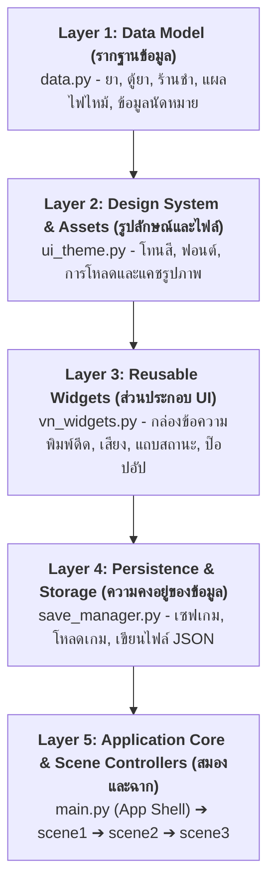
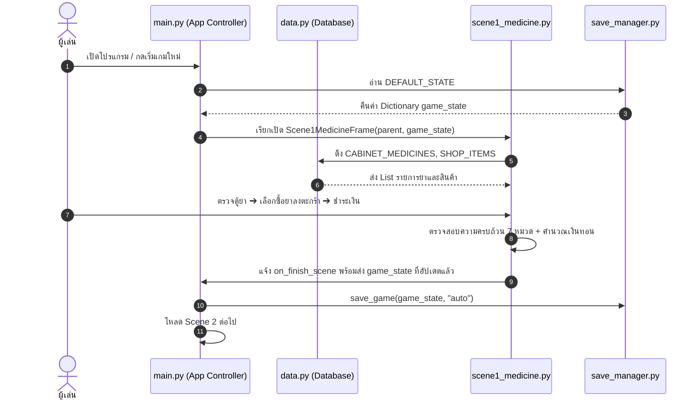
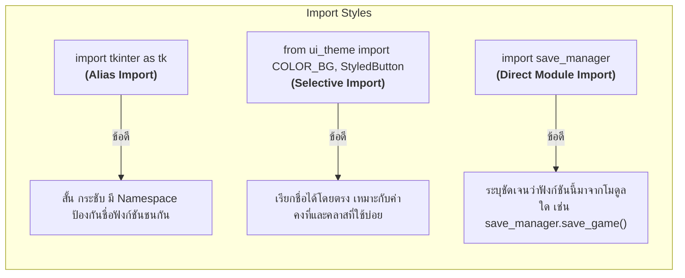
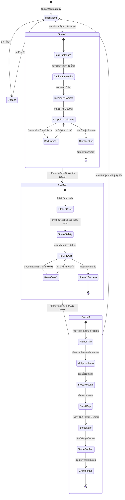
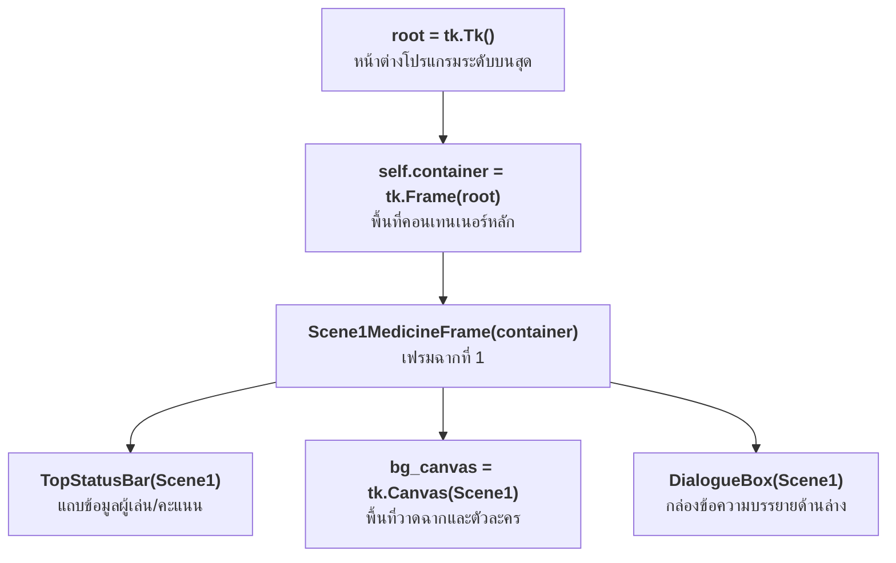

# คู่มือการเรียนรู้และสร้างสถาปัตยกรรมโปรแกรม Visual Novel จากศูนย์สู่ผู้เชี่ยวชาญ
**โปรเจกต์:** Stay Alive, Tee!: เมทข้าต้องรอด! (Pharmacy Afterlife — HA-01)  
**ระดับ:** ผู้เริ่มต้นที่ไม่มีพื้นฐาน Python จนถึงระดับสามารถออกแบบและเขียนเองได้ (Beginner to Architect)  
**บทบาทผู้สอน:** Senior Python Developer & Architecture Tutor  

---

## สารบัญการเรียนรู้ (Curriculum Table of Contents)

- [แนวคิดของสถาปนิกซอฟต์แวร์: ถ้าเราเป็นคนเขียน จะเริ่มจากตรงไหน?](#แนวคิดของสถาปนิกซอฟต์แวร์-ถ้าเราเป็นคนเขียน-จะเริ่มจากตรงไหน)
- [ส่วนที่ 1: ตรวจสอบโปรเจกต์ทั้งหมด (Project Overview & Architecture)](#ส่วนที่-1-ตรวจสอบโปรเจกต์ทั้งหมด-project-overview--architecture)
- [ส่วนที่ 2: อธิบาย Modules และ Imports ทั้งหมด (Library & Module Guide)](#ส่วนที่-2-อธิบาย-modules-และ-imports-ทั้งหมด-library--module-guide)
- [ส่วนที่ 3: สำรวจตัวแปรและโครงสร้างข้อมูลทั้งหมด (Data Dictionary & Deep Dive)](#ส่วนที่-3-สำรวจตัวแปรและโครงสร้างข้อมูลทั้งหมด-data-dictionary--deep-dive)
- [ส่วนที่ 4: อธิบายฟังก์ชันและการออกแบบเชิงโครงสร้าง (Function Registry & Execution Scope)](#ส่วนที่-4-อธิบายฟังก์ชันและการออกแบบเชิงโครงสร้าง-function-registry--execution-scope)
- [ส่วนที่ 5: อธิบาย Logic และลำดับการทำงาน (State Machine & Logic Flow)](#ส่วนที่-5-อธิบาย-logic-และลำดับการทำงาน-state-machine--logic-flow)
- [ส่วนที่ 6: สอนโค้ดทีละบรรทัดตามลำดับที่ควรเริ่มเขียน (Step-by-Step Code Walkthrough)](#ส่วนที่-6-สอนโค้ดทีละบรรทัดตามลำดับที่ควรเริ่มเขียน-step-by-step-code-walkthrough)
- [ส่วนที่ 7: สอน GUI และ Event Handling (Tkinter Visual Novel Mastery)](#ส่วนที่-7-สอน-gui-และ-event-handling-tkinter-visual-novel-mastery)
- [ส่วนที่ 8: การบันทึกข้อมูลและไฟล์ (Save/Load & File I/O Mechanics)](#ส่วนที่-8-การบันทึกข้อมูลและไฟล์-saveload--file-io-mechanics)
- [ส่วนที่ 9: Debugging และการทดสอบ (Testing & Error Handling Guide)](#ส่วนที่-9-debugging-และการทดสอบ-testing--error-handling-guide)
- [ส่วนที่ 10: แบบฝึกหัดพัฒนาฝีมือจนเขียนเองได้ (Interactive Exercises & Solutions)](#ส่วนที่-10-แบบฝึกหัดพัฒนาฝีมือจนเขียนเองได้-interactive-exercises--solutions)

---

# แนวคิดของสถาปนิกซอฟต์แวร์: ถ้าเราเป็นคนเขียน จะเริ่มจากตรงไหน?

ก่อนจะเขียนโค้ดบรรทัดแรก คนทั่วไปมักเริ่มเปิดโปรแกรมแล้วพิมพ์หน้าต่าง GUI ทันที ซึ่งเป็นวิธีที่ทำให้โค้ดพันกันยุ่งเหยิง (Spaghetti Code)  
ในฐานะ **Senior Python Developer** หากเราต้องสร้างเกมนี้ขึ้นมาจากกระดาษเปล่า เราจะแบ่งกระบวนการคิดออกเป็น **5 ชั้นสถาปัตยกรรม (5-Layer Architecture Pipeline)** ดังนี้:



### ลำดับขั้นตอนการลงมือเขียนจริง (Implementation Order):
1. **เริ่มเขียน `data.py` ก่อนเสมอ:** กำหนดว่าเกมนี้มี "ข้อมูลอะไรบ้าง" เช่น ยามีกี่ตัว แต่ละตัวชื่ออะไร ราคาเท่าไร อะไรคือยาจำเป็น หากไม่มีข้อมูล เราจะไม่รู้เลยว่าหน้าจอต้องเอาอะไรมาแสดงผล
2. **สร้าง `ui_theme.py`:** กำหนด "ดีไซน์ระบบ" (Design System) รหัสสีเข้ม-สว่าง ขนาดฟอนต์ และฟังก์ชันโหลดรูปภาพพร้อมระบบแคช (Image Cache) เพื่อไม่ให้โหลดไฟล์ซ้ำๆ จนเปลืองหน่วยความจำ
3. **สร้าง `vn_widgets.py`:** สร้าง "คอมโพเนนต์ที่ใช้ซ้ำได้" เช่น กล่องบทสนทนาที่มีเอฟเฟกต์พิมพ์ดีด (Typewriter Effect), แถบสถานะบนหัวจอ (TopStatusBar), และปุ่มกดสำเร็จรูป (StyledButton)
4. **สร้าง `save_manager.py`:** กำหนดสถานะเริ่มต้นของเกม (`DEFAULT_STATE`) และระบบอ่านเขียนไฟล์ JSON เพื่อให้เซฟเกมได้ตั้งแต่เนิ่นๆ
5. **สร้าง `main.py`:** ทำหน้าที่เป็นหน้าต่างหลัก (`Tk()`) จัดการระบบเมนู การสลับหน้าจอ (Page Router) และการดักจับปุ่มกดคีย์บอร์ดระดับสากล (`<Escape>`)
6. **สร้างฉากเกมทีละฉาก (`scene1_medicine.py` ➔ `scene2_burn_firstaid.py` ➔ `scene3_mohpromt.py`):** แต่ละฉากสืบทอดคุณสมบัติมาจาก `tk.Frame` สามารถสร้าง แยกทดสอบ และเชื่อมโยงต่อกันอย่างอิสระ
7. **เขียนสคริปต์ทดสอบอัตโนมัติ (`test_full_game.py`):** เพื่อทดสอบว่าทุกการเปลี่ยนฉากและการคิดคะแนนทำงานถูกต้องโดยไม่ต้องคลิกเล่นมือใหม่ทุกครั้ง

---

# ส่วนที่ 1: ตรวจสอบโปรเจกต์ทั้งหมด (Project Overview & Architecture)

### 1.1 ภาพรวมและฟีเจอร์ของโปรแกรม
**Stay Alive, Tee!: เมทข้าต้องรอด!** เป็นเกมประเภท **Educational Visual Novel (นิยายภาพจำลองสถานการณ์เพื่อการศึกษา)** พัฒนาด้วยภาษา Python และ GUI มาตรฐาน Tkinter ผสานการเรียนรู้เรื่องยาและการดูแลสุขภาพแบบ Interactive:

* **ฉากที่ 1 (ตู้ยาสามัญประจำบ้านและการบริหารงบ 1,000 บาท):**
  * ตรวจสอบยา 8 ชิ้นในตู้ยาหอพัก ดูวันหมดอายุ สภาพเม็ดยา การแยกชั้น ตะกอน และเชื้อรา
  * ตัดสินใจ "ทิ้ง" หรือ "เก็บ" ยาแต่ละชิ้น พร้อมเหตุผลทางการแพทย์
  * ช้อปปิ้งซื้อยาเติมสต็อก 7 กลุ่มจำเป็น โดยมีงบจำกัด 1,000 บาท หากซื้อไม่ครบจะเข้าสู่ **Bad Ending (วิกฤตกลางดึก)** แต่ถ้าบริหารเงินเหลือ $\ge 200$ บาท จะได้ไปกิน Sushiro กับที
  * จัดเก็บยาเข้าตู้ให้ถูกวิธี (ห้ามเก็บในห้องน้ำ หลังตู้เย็น หรือที่ชื้น)
* **ฉากที่ 2 (วิกฤตน้ำร้อนลวกและการปฐมพยาบาลศิริราช):**
  * ประเมินความปลอดภัยของสถานที่เกิดเหตุ (Scene Safety)
  * ประเมินระดับความลึกของแผล (ระดับ 2 ชนิดตื้น มีตุ่มพองใส Blister)
  * ทำแบบทดสอบการปฐมพยาบาล 6 ขั้นตอนตามมาตรฐาน รพ.ศิริราช (ระบายความร้อนด้วยน้ำสะอาดอุณหภูมิห้องไหลผ่าน 15–20 นาที, ถอดแหวนทันที, ห้ามเจาะตุ่มพอง, ห้ามใช้น้ำแข็ง/ยาสีฟัน) มีโอกาสตอบผิดได้ไม่เกิน 3 ครั้ง (ระบบ 3 หัวใจ)
* **ฉากที่ 3 (การใช้งานแอปพลิเคชันหมอพร้อมเพื่อสุขภาพดิจิทัล):**
  * จำลองสมาร์ตโฟนเสมือนจริง (Interactive Phone Canvas)
  * ทำตามขั้นตอนการจองคิวนัดหมายแพทย์ 4 สเต็ป: เลือก รพ., แผนก, วันที่นัดล่วงหน้า (ระบบสร้างปฏิทินจริง 3 เดือน), และยืนยันรับใบนัดหมายดิจิทัล
* **ฟีเจอร์สนับสนุนทั้งระบบ:**
  * ระบบบันทึกเกม 4 สล็อต (Slot 1, 2, 3 และ Auto-Save) พร้อมข้อมูล วันที่-เวลา, ฉาก, คะแนน
  * ระบบประวัติบทสนทนาย้อนหลัง (Dialogue History Log)
  * ระบบปรับความเร็วตัวอักษรและระดับเสียงในหน้า Options
  * คู่มือโปสเตอร์ยาสามัญประจำบ้าน 11 หมวด พร้อมระบบกระโดดข้ามหมวด

---

### 1.2 โครงสร้างโฟลเดอร์และไฟล์
```text
📁 khim-project/
├── 📄 main.py                    # Entry Point หลัก, Shell หน้าต่าง, เมนู, Page Router
├── 📄 data.py                    # Single Source of Truth สำหรับข้อมูลยา, ตู้ยา, ร้านชำ, แผลไฟไหม้
├── 📄 ui_theme.py                # ระบบธีมสี Dark Cyber-Clinic, ฟอนต์, ImageManager Cache, StyledButton
├── 📄 vn_widgets.py              # คลาสคอมโพเนนต์: DialogueBox (Typewriter), TopStatusBar, Popups
├── 📄 save_manager.py            # ตัวจัดการ Multi-slot Save System และอ่านเขียนไฟล์ JSON
├── 📄 scene1_medicine.py         # คลาส Scene1MedicineFrame (ตรวจตู้ยา, ช้อปปิ้งงบ 1,000 บาท, จัดเก็บยา)
├── 📄 scene2_burn_firstaid.py    # คลาส Scene2BurnFirstAidFrame (ปฐมพยาบาลน้ำร้อนลวกตามเกณฑ์ศิริราช)
├── 📄 scene3_mohpromt.py         # คลาส Scene3MohpromtFrame (จำลองการจองคิวแอปหมอพร้อม 4 สเต็ป)
├── 📁 photo/                     # คลังรูปภาพจัดระเบียบ 3 หมวดย่อย
│   ├── 📁 bg/                    # ภาพพื้นหลัง (bg_dorm, bg_kitchen, bg_pharmacy, bg_restaurant)
│   ├── 📁 med/                   # ภาพยาและเวชภัณฑ์ (paracetamol, betadine, ors, saline, etc.)
│   └── 📁 tee/                   # ภาพสไปรต์ตัวละครที (tee_happy, tee_panicked, tee_sleepy)
├── 📁 sounds/                    # ไฟล์เสียงเอฟเฟกต์ (typewriter.wav, advance.wav)
├── 📁 saves/                     # ไฟล์บันทึกสถานะเกม (save_slot1.json, save_auto.json, etc.)
└── 📁 scripts/
    └── 📄 test_full_game.py      # ชุดทดสอบ Headless Unit Test ครอบคลุมทุกเส้นทางการเล่น
```

---

### 1.3 จุดเริ่มต้นการทำงานและ Life Cycle
1. ผู้ใช้รันคำสั่ง `python main.py`
2. ระบบเริ่มทำงานที่บล็อก `if __name__ == "__main__":` ใน `main.py`
3. สร้างหน้าต่างราก `root = tk.Tk()` พร้อมกำหนดขนาด `1024x720` พิกเซล
4. อินสแตนซ์คลาสหลัก `app = PharmacyAfterlifeApp(root)` ถูกสร้างขึ้น
5. `app` เริ่มต้นสถานะเกมด้วย `save_manager.DEFAULT_STATE.copy()`
6. สร้างโครงหน้าต่างคอนเทนเนอร์ สลับหน้าแรกไปยัง `self.menu_frame` (เมนูหลัก)
7. รันลูปเหตุการณ์ `root.mainloop()` เพื่อรอรับการคลิกเมาส์และการกดคีย์บอร์ด
8. เมื่อผู้เล่นกด "เริ่มเกมใหม่" $\rightarrow$ เรียก `load_scene("scene1")`
9. เมื่อจบฉากที่ 1 $\rightarrow$ บันทึกคะแนนลง `game_state` แล้วสลับไป `scene2`
10. เมื่อจบฉากที่ 2 $\rightarrow$ สลับไป `scene3`
11. เมื่อจบฉากที่ 3 $\rightarrow$ แสดง Grand Finale Card และสรุปผลการประเมิน จากนั้นกลับสู่เมนูหลัก

---

### 1.4 ความสัมพันธ์ระหว่างไฟล์และการไหลของข้อมูล (Data Flow)



---

### 1.5 ข้อเท็จจริงในโค้ด vs ข้อเสนอแนะในการปรับปรุง
* **ข้อเท็จจริง (Facts):**
  * โปรแกรมเป็นแบบ Single-Threaded Event-Driven อาศัย `root.after()` ของ Tkinter ในการสร้างแอนิเมชันพิมพ์ดีด โดยไม่ต้องใช้ Threading
  * เสียงเอฟเฟกต์อาศัยไลบรารีมาตรฐาน `winsound` ซึ่งรันได้เฉพาะบนระบบปฏิบัติการ Windows เท่านั้น
  * ข้อมูลระหว่างฉากส่งผ่านการอ้างอิง Dictionary ชุดเดียวกัน (`self.game_state`) ทำให้ทุกฉากแก้ไขและส่งต่อคะแนนได้โดยตรง
* **ข้อเสนอแนะเพื่อการต่อยอด (Recommendations):**
  * หากต้องการพอร์ตเกมไปรันบน macOS หรือ Linux ควรใช้โมดูลเสียงข้ามแพลตฟอร์ม เช่น `pygame.mixer`
  * สามารถเพิ่มระบบ Localization (รองรับภาษาอังกฤษ/ไทย) โดยแยก String ออกมาเป็นตารางภาษา

---

# ส่วนที่ 2: อธิบาย Modules และ Imports ทั้งหมด (Library & Module Guide)

### 2.1 ตารางวิเคราะห์โมดูลที่ใช้จริงในโปรเจกต์

| ชื่อโมดูล / ไลบรารี | คำสั่ง Import ที่ใช้จริง | ชนิดของไลบรารี | หน้าที่ในโปรเจกต์ | ทำไมต้องใช้? (เหตุผล) | หากนำออกจะเกิดอะไรขึ้น? | ทางเลือกอื่น (Alternatives) |
| :--- | :--- | :--- | :--- | :--- | :--- | :--- |
| **tkinter** | `import tkinter as tk`<br/>`from tkinter import ttk, messagebox` | มาตรฐาน Python | สร้างหน้าต่าง GUI, ปุ่ม, การ์ด, ข้อความ, หน้าต่างแจ้งเตือน | เป็น GUI Framework มาตรฐาน ไม่ต้องติดตั้งเพิ่ม ทำงานเร็ว | โปรแกรมจะไม่สามารถแสดงหน้าต่างภาพได้เลย รันไม่ขึ้น | PyQt, PySide, CustomTkinter, Pygame |
| **PIL (Pillow)** | `from PIL import Image, ImageTk` | ภายนอก (Third-party) | เปิด อ่าน ย่อ-ขยายภาพ PNG/JPG และแปลงเป็นรูปแบบที่ Tkinter วาดได้ | Tkinter รุ่นมาตรฐานแสดงผลได้จำกัดและปรับขนาดภาพไม่ได้ Pillow ช่วยลดรอยหยักด้วย `LANCZOS` | โปรแกรมจะแสดงได้เฉพาะข้อความ ไม่มีภาพประกอบใดๆ เกิด `ImportError` | ใช้รูปภาพขนาดตายตัวที่เป็น `.png` ล้วนผ่าน `tk.PhotoImage` |
| **json** | `import json` | มาตรฐาน Python | แปลงสถานะเกมในหน่วยความจำ (RAM) เป็นข้อความ JSON บันทึกลงฮาร์ดดิสก์ | เป็นรูปแบบมาตรฐานที่มนุษย์อ่านและแก้ไขง่าย มีความปลอดภัยสูง | ระบบบันทึกเกม (Save/Load) จะไม่สามารถทำงานได้ | `pickle`, `sqlite3`, `csv` |
| **os** | `import os` | มาตรฐาน Python | จัดการพาธโฟลเดอร์ ค้นหาไฟล์ภาพ ตรวจสอบไฟล์เซฟ สร้างโฟลเดอร์ | ป้องกันปัญหา Path พังเมื่อรันบนเครื่องอื่น ด้วย `os.path.join()` | โปรแกรมหาไฟล์รูปภาพและไฟล์เซฟไม่เจอ โปรแกรมแครช | `pathlib.Path` |
| **sys** | `import sys` | มาตรฐาน Python | จัดการ Path การค้นหาโมดูลในสคริปต์ทดสอบ `sys.path.insert()` | ช่วยให้ไฟล์ในโฟลเดอร์ `scripts/` มองเห็นและ import โมดูลหลักได้ | รันไฟล์ทดสอบใน `scripts/test_full_game.py` ไม่ผ่าน | ตั้งค่าตัวแปร `PYTHONPATH` ใน Command Line |
| **datetime** | `from datetime import datetime`<br/>`import datetime` | มาตรฐาน Python | ประทับเวลาไฟล์เซฟ (`strftime`) และคำนวณวันนัดหมายล่วงหน้า 3 เดือนในฉากหมอพร้อม | ช่วยจัดการเรื่องปี พ.ศ., ชื่อวันภาษาไทย และปฏิทินที่ถูกต้อง | วันที่ในใบเซฟและระบบนัดหมายแพทย์จะไม่ทำงาน | โมดูลภายนอกอย่าง `pendulum` หรือ `dateutil` |
| **winsound** | `import winsound` | มาตรฐาน Python (Windows Only) | เล่นไฟล์เสียงเอฟเฟกต์ `.wav` แบบอะซิงโครนัส (`SND_ASYNC`) | มีมาพร้อมกับ Python บน Windows ใช้งานง่าย ไม่หน่วงเวลาโปรแกรม | เกมจะไม่มีเสียงพิมพ์ดีดและเสียงกดปุ่ม | `pygame.mixer`, `playsound`, `simpleaudio` |
| **ctypes** | `import ctypes` | มาตรฐาน Python | ปรับระดับเสียง Master Volume ของระบบปฏิบัติการ Windows ผ่าน `winmm.dll` | รองรับสไลเดอร์ปรับระดับเสียงจริงในหน้าตั้งค่า | ปรับระดับเสียงในหน้าต่าง Options ไม่ได้ | อาศัยให้ผู้เล่นปรับเสียงลำโพงคอมพิวเตอร์เอง |

---

### 2.2 เปรียบเทียบรูปแบบการ Import: `import x`, `import x as y` และ `from x import y`

ในโปรเจกต์นี้เราใช้ทั้ง 3 รูปแบบตามความเหมาะสมของสถาปัตยกรรม:



1. **`import tkinter as tk` (Import with Alias):**  
   * **เหตุผลที่ใช้:** โมดูล `tkinter` มีคลาสและฟังก์ชันหลายร้อยตัว การย่อชื่อเหลือ `tk` ช่วยให้เขียนโค้ดสั้นลง เช่น `tk.Frame` แทนที่จะเป็น `tkinter.Frame` และยังคง Namespace เพื่อให้ผู้อ่านรู้ทันทีว่าเป็นวิดเจ็ตของ Tkinter ไม่ใช่คลาสที่เราเขียนขึ้นเอง
2. **`from ui_theme import COLOR_BG, COLOR_ACCENT, StyledButton` (Selective Import):**  
   * **เหตุผลที่ใช้:** ค่าคงที่ของสีและคลาสปุ่มถูกเรียกใช้ถี่มากในเกือบทุกบรรทัดของ GUI การดึงชื่อออกมาตรงๆ ทำให้โค้ดสะอาดตา เช่น `bg=COLOR_BG` อ่านง่ายกว่า `bg=ui_theme.COLOR_BG`
3. **`import save_manager` (Direct Module Import):**  
   * **เหตุผลที่ใช้:** ฟังก์ชันในโมดูลนี้เกี่ยวข้องกับ I/O ดิสก์ เช่น `save_manager.save_game(...)` การคงชื่อโมดูลไว้ข้างหน้าช่วยเตือนใจผู้พัฒนาว่าคำสั่งนี้กำลังเขียนไฟล์ลงเครื่อง

---

# ส่วนที่ 3: สำรวจตัวแปรและโครงสร้างข้อมูลทั้งหมด (Data Dictionary & Deep Dive)

### 3.1 ตัวแปรระดับแอปพลิเคชันและวงจรชีวิต (Application Variables & Lifecycle)

| ชื่อตัวแปร | ตำแหน่งที่ประกาศ | ชนิดข้อมูล | ค่าเริ่มต้น | หน้าที่ในระบบ | ขอบเขต (Scope) | ความเสี่ยงหากแก้ไขผิดพลาด |
| :--- | :--- | :--- | :--- | :--- | :--- | :--- |
| `DEFAULT_STATE` | `save_manager.py` บรรทัด 14 | `dict` | ดูโครงสร้างด้านล่าง | แม่แบบสถานะเริ่มต้นของเกม | Module Constant | หากคีย์ใดหายไป ฉากที่เรียกใช้คีย์นั้นจะเกิด `KeyError` ทันที |
| `game_state` | `main.py` บรรทัด 39 (`self.game_state`) | `dict` | คัดลอกจาก `DEFAULT_STATE` | เก็บสถานะผู้เล่น คะแนน ความสัมพันธ์ ฉากปัจจุบัน | Instance Attribute | หากเผลอเซ็ตเป็นค่าว่าง ข้อมูลผู้เล่นจะสูญหายทันที |
| `PRODUCTS` | `data.py` บรรทัด 14 | `dict` | ดิกชันนารี 19 ไอเทม | คลังสเปกยาและสินค้า (Single Source of Truth) | Module Constant | หากแก้ Product ID ในนี้ ต้องแก้ใน `SHOP_CATALOG` และ `CABINET_INVENTORY` ด้วย |
| `CABINET_INVENTORY` | `data.py` บรรทัด 240 | `list[dict]` | ลิสต์ยา 8 รายการ | สถานะจริงของยาในตู้ยาหอพักของที | Module Constant | หากแก้จำนวนรายการในนี้ ต้องปรับตัวนับใน `scene1_medicine.py` |
| `SHOP_CATALOG` | `data.py` บรรทัด 335 | `list[dict]` | ลิสต์สินค้า 16 รายการ | ข้อมูลสินค้า ราคาสินค้า และสต็อกในร้านค้า | Module Constant | หากระบุราคาเป็นข้อความ `str` แทน `int` การคำนวณเงินจะพัง |
| `shopping_cart` | `scene1_medicine.py` บรรทัด 31 | `set` | `set()` (เซตว่าง) | เก็บ ID สินค้าที่ผู้เล่นหยิบใส่ตะกร้าในร้านชำ | Instance Attribute | การใช้ `set` ป้องกันสินค้าซ้ำได้โดยอัตโนมัติ |
| `checked_medicines` | `scene1_medicine.py` บรรทัด 30 | `dict` | `{}` (ดิกชันนารีว่าง) | บันทึกคำตัดสินของยาในตู้ (`True`=เสีย, `False`=ดี) | Instance Attribute | หากลืมอัปเดต ผู้เล่นจะไม่สามารถกดเสร็จสิ้นการตรวจตู้ยาได้ |
| `mistakes_count` | `scene2_burn_firstaid.py` บรรทัด 30 | `int` | `0` | นับจำนวนครั้งที่ตอบผิดในการปฐมพยาบาล (จำกัด 3 ครั้ง) | Instance Attribute | หากไม่นับเพิ่ม ผู้เล่นจะไม่มีวัน Game Over |

---

### 3.2 โครงสร้างข้อมูลแบบซ้อนลึก (Nested Data Structures) และวิธีเข้าถึง

#### ก. โครงสร้างสถานะเกม (`game_state`)
```python
game_state = {
    "player_name": "นักศึกษาหัวร้อน",       # str: ชื่อผู้เล่น
    "score": 0,                             # int: คะแนนความรู้สุขภาพสะสม
    "relationship": 50,                     # int: ระดับความสัมพันธ์กับที (0-100)
    "current_scene": "scene1",              # str: ฉากปัจจุบัน ("scene1", "scene2", "scene3")
    "scene_step": 0,                        # int: สเต็ปย่อยในฉาก
    "completed_scenes": [],                 # list[str]: รหัสฉากที่ผ่านแล้ว
    "inventory": [],                        # list[str]: ไอเทมที่ซื้อมาจากร้านยา
    "remaining_budget": 1000,               # int: เงินคงเหลือจากงบ 1,000 บาท
    "playtime_notes": "เริ่มการเดินทางในหอพัก",# str: คำอธิบายประกอบหน้าเซฟ
    "saved_at": "15/10/2026 09:30:00"       # str: วันที่และเวลาที่บันทึก
}
```
* **วิธีเข้าถึงข้อมูล:**
  ```python
  # 1. อ่านค่าชื่อผู้เล่น
  name = game_state["player_name"]  # ได้ "นักศึกษาหัวร้อน"
  
  # 2. เพิ่มคะแนน 20 แต้ม
  game_state["score"] += 20
  
  # 3. ตรวจสอบว่าเคยผ่านฉากที่ 1 แล้วหรือยัง
  if "scene1" in game_state["completed_scenes"]:
      print("เคยผ่านฉาก 1 แล้ว")
  ```

#### ข. โครงสร้างฐานข้อมูลยา (`PRODUCTS` ซ้อนใน `CABINET_INVENTORY`)
ใน `data.py` เราออกแบบให้ `CABINET_INVENTORY` เก็บเพียง `product_id` แล้วใช้ฟังก์ชัน `get_cabinet_medicines()` ไปดึงข้อมูลสเปกจาก `PRODUCTS`:

```python
# ตัวอย่างข้อมูลจริงใน data.py
PRODUCTS["para_tab"] = {
    "name": "ยาพาราเซตามอล 500 มก.",
    "category": "ยาบรรเทาปวด ลดไข้",
    "cat_key": "pain",
    "description": "ยาแก้ปวดลดไข้สามัญประจำบ้าน สำหรับไข้ ปวดศีรษะ ปวดเมื่อย",
    "image": "paracetamol_tab.png"
}

CABINET_INVENTORY[0] = {
    "slot_id": "med1",
    "product_id": "para_tab",
    "expiry_date": "หมดอายุเมื่อ 3 เดือนก่อน",
    "appearance": "เม็ดยาเปลี่ยนเป็นสีเหลือง มีจุดด่างสีน้ำตาล เม็ดยาบวมชื้นและแตกร่วนเป็นผง",
    "is_spoiled": True,
    "spoilage_reason": "เม็ดยาชื้น บวม แตกหัก และหมดอายุ ต้องทิ้งทันที!"
}
```

* **วิธีเชื่อมโยงข้อมูล 2 ชั้น (Data Joins in Python):**
  ```python
  # ต้องการชื่อยาและเหตุผลที่ยาในตู้ชิ้นที่ 1 เสียหาย:
  cabinet_item = CABINET_INVENTORY[0]
  prod_spec = PRODUCTS[cabinet_item["product_id"]]
  
  print(f"ชื่อยา: {prod_spec['name']}")
  print(f"สภาพที่พบ: {cabinet_item['appearance']}")
  print(f"เหตุผลที่ต้องทิ้ง: {cabinet_item['spoilage_reason']}")
  ```

---

# ส่วนที่ 4: อธิบายฟังก์ชันและการออกแบบเชิงโครงสร้าง (Function Registry & Execution Scope)

### 4.1 ตารางฟังก์ชันและเมธอดสำคัญในระบบ

| ชื่อฟังก์ชัน / เมธอด | สังกัดไฟล์ / คลาส | พารามิเตอร์ | ค่าที่ส่งคืน (`return`) | หน้าที่และการทำงาน |
| :--- | :--- | :--- | :--- | :--- |
| `get_image(filename, size)` | `ui_theme.py` | `filename: str`<br/>`size: tuple(w, h)` | `ImageTk.PhotoImage` หรือ `None` | โหลดภาพจากโฟลเดอร์ ค้นหา `.png` ก่อนเสมอ ปรับขนาดด้วย Lanczos และเก็บลงแคช |
| `save_game(game_state, slot_id)` | `save_manager.py` | `game_state: dict`<br/>`slot_id: str` | `bool` (สำเร็จหรือไม่) | คัดลอก `game_state` เติมวันเวลาปัจจุบัน แล้วเขียนไฟล์ลง `saves/save_{slot_id}.json` |
| `load_game(slot_id)` | `save_manager.py` | `slot_id: str` | `dict` หรือ `None` | อ่านไฟล์ JSON ผสานค่าเข้ากับ `DEFAULT_STATE` เพื่อป้องกันคีย์ตกหล่น |
| `show_page(frame)` | `main.py`<br/>`PharmacyAfterlifeApp` | `frame: tk.Frame` | ไม่มี (`None`) | สลับหน้าจอหลักโดยใช้ `frame.place()` และยกขึ้นมาบนสุดด้วย `frame.tkraise()` |
| `handle_escape_key(event)` | `main.py`<br/>`PharmacyAfterlifeApp` | `event=None` | `"break"` หรือ `None` | ระบบดักจับปุ่ม Esc ตรวจสอบบริบท: ปิด Popup ➔ เมนู ➔ ถาม Auto-save |
| `select_medicine_to_inspect(med)` | `scene1_medicine.py`<br/>`Scene1MedicineFrame` | `med: dict` | ไม่มี (`None`) | อัปเดตการ์ดแสดงรายละเอียดของยาที่กำลังตรวจ วันหมดอายุ และรูปตัวอย่าง |
| `judge_medicine(med, decision)` | `scene1_medicine.py`<br/>`Scene1MedicineFrame` | `med: dict`<br/>`decision: bool` | ไม่มี (`None`) | ตรวจสอบว่าผู้เล่นตัดสินใจถูกหรือไม่ (เก็บ vs ทิ้ง) ให้คะแนน และบันทึกลง `checked_medicines` |
| `toggle_shop_item(item)` | `scene1_medicine.py`<br/>`Scene1MedicineFrame` | `item: dict` | ไม่มี (`None`) | สลับสถานะหยิบเข้า/เอาออกจากตะกร้า (`shopping_cart`) และอัปเดตยอดเงินทันที |
| `handle_step_choice(opt, step_data)`| `scene2_burn_firstaid.py`<br/>`Scene2BurnFirstAidFrame`| `opt: dict`<br/>`step_data: dict` | ไม่มี (`None`) | ตรวจคำตอบการปฐมพยาบาล หากถูกให้คะแนน หากผิดตัดหัวใจ ถ้าผิดครบ 3 ครั้งเข้าสู่ Game Over |

---

### 4.2 ทำความเข้าใจ Scope, Mutability, Callbacks และ Parameter Passing

สำหรับผู้เริ่มต้น หัวใจสำคัญที่สุดของ Python 4 ประการที่ปรากฏในโค้ดนี้คือ:

#### 1. ความแตกต่างระหว่าง Mutable และ Immutable
* **Immutable (แก้ไขค่าในที่เดิมไม่ได้):** `int`, `float`, `str`, `tuple`, `bool`  
  เมื่อเราส่ง `score = 0` เข้าฟังก์ชันแล้วข้างในสั่ง `score += 10` ตัวแปรข้างนอกจะไม่เปลี่ยน!
* **Mutable (แก้ไขข้อมูลข้างในวัตถุเดิมได้ทันที):** `dict`, `list`, `set`  
  ในโปรเจกต์นี้ `game_state` เป็น `dict` เมื่อเราส่ง `self.game_state` ไปยัง `Scene1MedicineFrame` แล้วในฉากนั้นสั่ง `self.game_state["score"] += 50` **ข้อมูลที่อยู่ใน `main.py` จะถูกอัปเดตด้วยทันที** เพราะชี้ไปที่หน่วยความจำก้อนเดียวกัน (Pass by Assignment)

#### 2. Callback Functions
ใน Tkinter เราไม่สั่งให้ฟังก์ชันทำงานทันทีตอนสร้างปุ่ม แต่เราส่ง **"ชื่อฟังก์ชัน"** ไปให้ปุ่มเก็บไว้ แล้วปุ่มจะย้อนกลับมาเรียกเองเมื่อเกิดการคลิก:
```python
# ❌ ผิดมหันต์: ใส่เครื่องหมายวงเล็บ () จะทำให้ฟังก์ชันทำงานทันทีตั้งแต่ตอนเริ่มโปรแกรม!
btn = tk.Button(parent, text="บันทึก", command=self.save_game())

# ✅ ถูกต้อง: ส่งเฉพาะชื่อฟังก์ชัน (ไม่ใส่วงเล็บ) ให้เป็น Callback
btn = tk.Button(parent, text="บันทึก", command=self.save_game)
```

#### 3. การใช้ `lambda` ส่งอาร์กิวเมนต์ให้ Callback
หากฟังก์ชันต้องการรับค่า เช่น ต้องการส่งไอเทมที่กดเข้าไปด้วย เราจะใช้ `lambda` ทำหน้าที่เป็นฟังก์ชันนิรนามห่อไว้:
```python
# ใช้ lambda ชะลอการทำงาน รอจนกว่าจะมีการคลิกปุ่มจริงๆ จึงเรียก toggle_shop_item(item)
btn = StyledButton(row, text="➕ หยิบใส่", command=lambda i=item: self.toggle_shop_item(i))
```
> **เคล็ดลับระดับโปร:** สังเกตการเขียน `lambda i=item:` แทนที่จะเป็น `lambda: self.toggle_shop_item(item)` การเขียน `i=item` เป็นการตรึงค่า (Default Argument Binding) ป้องกันปัญหาตัวแปรใน Loop ชี้ไปที่ไอเทมตัวสุดท้ายตัวเดียว!

---

# ส่วนที่ 5: อธิบาย Logic และลำดับการทำงาน (State Machine & Logic Flow)

### 5.1 State Machine ของเกมทั้งหมด



---

### 5.2 การตรวจสอบเงื่อนไขที่สำคัญและการจัดการ Edge Cases

#### 1. การคำนวณงบประมาณและเงื่อนไขการจบในฉากที่ 1 (`handle_checkout`)
* **เงื่อนไขเงินเกินงบ:**
  ```python
  total_spent = sum(item["price"] for item in SHOP_ITEMS if item["id"] in self.shopping_cart)
  if total_spent > self.shopping_budget: # shopping_budget = 1000
      # ระงับการชำระเงิน แสดงป๊อปอัปเตือน และ Disable ปุ่มชำระเงิน
      return
  ```
* **เงื่อนไขยาบังคับ 7 หมวด:**
  ```python
  required_categories = {"pain", "allergy", "ors", "stomach", "nss", "betadine", "gauze"}
  cart_items = [item for item in SHOP_ITEMS if item["id"] in self.shopping_cart]
  covered_cats = {item.get("cat_key") for item in cart_items if item.get("cat_key")}
  missing_cats = required_categories - covered_cats

  if len(missing_cats) > 0:
      # เกิด Bad Ending: ยาสามัญไม่พร้อม วิกฤตกลางดึก
      self.show_bad_ending_missing_meds(...)
      return
  ```
* **เงื่อนไขโบนัสกินซูชิ (Sushiro Ending):**
  หากเงินทอนคงเหลือ `remaining >= 200` บาท จะเกิดบทสนทนาพิเศษที่ทีและผู้เล่นตกลงไปฉลองกินซูชิสายพานด้วยกัน!

#### 2. กรณีผู้เล่นปิดโปรแกรมฉับพลัน หรือกดปุ่ม Esc กลางคัน
* มีระบบ Context-Aware Interception ใน `handle_escape_key()` ดักจับไม่ให้โปรแกรมปิดทันที แต่จะเปิด Dialog ถามยืนยัน พร้อมสั่ง `save_manager.save_game(self.game_state, "auto")` บันทึกเกมอัตโนมัติลงในสล็อต `auto` ทันที ผู้เล่นจึงสามารถเปิดเกมกลับมาเล่นต่อจากจุดเดิมได้เสมอ

---

# ส่วนที่ 6: สอนโค้ดทีละบรรทัดตามลำดับที่ควรเริ่มเขียน (Step-by-Step Code Walkthrough)

เราจะมาศึกษาโค้ดจริงทีละไฟล์ตามลำดับที่สถาปนิกซอฟต์แวร์ลงมือสร้าง เพื่อให้เห็นภาพชัดเจนที่สุด:

---

## ขั้นที่ 1: สร้างฐานข้อมูลและเนื้อหาเกม [`data.py`](file:///d:/project/khim-project/data.py)

### โค้ดส่วนที่ 1.1: พจนานุกรมสินค้าหลัก (`PRODUCTS`)
```python
PRODUCTS = {
    "para_tab": {
        "id": "para_tab",
        "name": "ยาพาราเซตามอล 500 มก.",
        "generic_name": "Paracetamol 500mg (ชนิดเม็ด)",
        "category": "ยาบรรเทาปวด ลดไข้",
        "cat_key": "pain",
        "role": "essential",
        "description": "ยาแก้ปวดลดไข้สามัญประจำบ้าน สำหรับไข้ ปวดศีรษะ ปวดเมื่อย",
        "image": "paracetamol_tab.png",
        "storage_rule": "เก็บที่อุณหภูมิห้องต่ำกว่า 30°C ในที่แห้ง พ้นแสงแดด"
    },
    # ... รายการยาตัวอื่นๆ ...
}
```

#### อธิบายไวยากรณ์และความหมายทีละบรรทัด:
1. `PRODUCTS = { ... }`:
   * เครื่องหมายปีกกา `{}` แสดงการสร้าง **Dictionary (พจนานุกรมข้อมูล)** ซึ่งเป็นโครงสร้างแบบคู่กุญแจ-ค่า (Key-Value Pairs)
   * `"para_tab"` คือ **Key** ที่ไม่ซ้ำกัน (Unique Identifier) สะดวกต่อการค้นหาด้วยความเร็วสูง $O(1)$
2. `"cat_key": "pain"`:
   * คีย์ย่อสำหรับใช้ในตรรกะคอมพิวเตอร์ (Machine-friendly Key) เช่น `"pain"` แทนกลุ่มยาแก้ปวด ลดไข้ เพื่อนำไปเช็คเงื่อนไขยา 7 หมวดบังคับในร้านค้า
3. `"role": "essential"`:
   * ระบุบทบาทของยา: `"essential"` (ยาจำเป็นพื้นฐาน), `"optional"` (ยาทางเลือกบรรเทาอาการ), `"specialized"` (ยาเฉพาะทาง เช่น ซิลเวอร์เดิร์มแผลไฟไหม้), และ `"dorm_supply"` (ของกินของใช้หอพัก)

---

### โค้ดส่วนที่ 1.2: ฟังก์ชันตัวแปลงข้อมูล (Resolvers)
```python
def get_cabinet_medicines():
    """สร้างรายการยาในตู้ยา (CABINET_MEDICINES) โดยรวมข้อมูลจาก PRODUCTS เข้ากับสถานะจริง"""
    medicines = []
    for item in CABINET_INVENTORY:
        prod = PRODUCTS.get(item["product_id"], {})
        cat_k = prod.get("cat_key")
        card_img = CAT_CARD_IMAGES.get(cat_k, "card_01_stomach.png")
        medicines.append({
            "id": item["slot_id"],
            "product_id": item["product_id"],
            "name": prod.get("name", "ยาไม่ระบุชื่อ"),
            "type": prod.get("category", "ยาสามัญทั่วไป"),
            "appearance": item["appearance"],
            "expiry_date": item["expiry_date"],
            "is_expired_or_spoiled": item["is_spoiled"],
            "reason": item["spoilage_reason"],
            "image": prod.get("image", ""),
            "card_image": card_img
        })
    return medicines
```

#### อธิบายไวยากรณ์และความหมายทีละบรรทัด:
1. `def get_cabinet_medicines():`:
   * คำสำคัญ `def` ย่อมาจาก Define เป็นการประกาศสร้างฟังก์ชันใหม่
2. `medicines = []`:
   * สร้าง **List (รายการว่าง)** สำหรับทยอยสะสมข้อมูล
3. `for item in CABINET_INVENTORY:`:
   * ลูป `for ... in ...` ดึงข้อมูลทีละชิ้นจากตู้ยา 8 ชิ้นออกมาเก็บในตัวแปร `item`
4. `prod = PRODUCTS.get(item["product_id"], {})`:
   * คำสั่ง `.get(key, default)` เป็นวิธีเข้าถึง Dictionary ที่ปลอดภัยที่สุด หากไม่พบคีย์ใน `PRODUCTS` จะส่งคืน `{}` ว่างๆ แทนที่จะทำให้โปรแกรมแครชด้วย `KeyError`
5. `medicines.append({ ... })`:
   * รวมข้อมูลสเปกจาก `PRODUCTS` และสภาพจริงจาก `item` เข้าด้วยกันเป็นดิกชันนารีใหม่ แล้วใส่ต่อท้ายลิสต์ด้วยคำสั่ง `.append()`
6. `return medicines`:
   * ส่งลิสต์ข้อมูลที่ประมวลผลเสร็จแล้วกลับคืนไปยังจุดที่เรียกใช้

---

## ขั้นที่ 2: ระบบธีมและการแคชรูปภาพ [`ui_theme.py`](file:///d:/project/khim-project/ui_theme.py)

### โค้ดส่วนที่ 2.1: ฟังก์ชันโหลดและแคชรูปภาพ (`get_image`)
```python
_image_cache = {}

def get_image(filename, size=None):
    if not filename:
        return None

    key = (filename, size)
    if key in _image_cache:
        return _image_cache[key]
```

#### ทำไมสถาปนิกต้องเขียนแบบนี้?
* **ปัญหาถ้าไม่ทำแคช:** การเปิดไฟล์ภาพจากฮาร์ดดิสก์ (`Image.open`) และการคำนวณย่อขยายภาพ (`resize`) กินเวลาซีพียูสูงมาก หากผู้เล่นเปิดดูยาซ้ำๆ หรือเลื่อนจอ Frame Rate ของเกมจะกระตุกอย่างรุนแรง
* **วิธีแก้:** เราสร้าง `_image_cache = {}` ขึ้นมา เมื่อโหลดภาพใดมาแล้ว 1 ครั้ง จะนำไปฝากไว้ในดิกชันนารี โดยใช้คู่ลำดับ `(ชื่อไฟล์, ขนาด)` เป็น Key ครั้งต่อไปที่ต้องการภาพเดิม โปรแกรมจะดึงจาก RAM ออกมาแสดงผลได้ทันทีในเวลาเกือบ 0 วินาที!

---

### โค้ดส่วนที่ 2.2: คลาสปุ่มดีไซน์พิเศษ (`StyledButton`)
```python
class StyledButton(tk.Button):
    def __init__(self, parent, text, command=None, bg=COLOR_SURFACE_LIGHT, fg=COLOR_TEXT_MAIN, 
                 hover_bg=COLOR_ACCENT, hover_fg=COLOR_BG, font=FONT_BODY_BOLD, **kwargs):
        
        self.default_bg = bg
        self.default_fg = fg
        self.hover_bg = hover_bg
        self.hover_fg = hover_fg

        super().__init__(parent, text=text, command=command, font=font, bg=self.default_bg, fg=self.default_fg, **kwargs)

        self.bind("<Enter>", self.on_enter)
        self.bind("<Leave>", self.on_leave)

    def on_enter(self, event=None):
        if self["state"] != "disabled":
            self.configure(bg=self.hover_bg, fg=self.hover_fg)

    def on_leave(self, event=None):
        if self["state"] != "disabled":
            self.configure(bg=self.default_bg, fg=self.default_fg)
```

#### อธิบายคอนเซปต์ Object-Oriented Programming (OOP):
1. `class StyledButton(tk.Button):`:
   * **การสืบทอดคุณสมบัติ (Inheritance):** เราไม่ได้สร้างปุ่มขึ้นมาใหม่จากศูนย์ แต่เราสืบทอดความสามารถทั้งหมดมาจาก `tk.Button` แล้วต่อยอดเฉพาะฟีเจอร์ที่เราต้องการ
2. `super().__init__(parent, ...)`:
   * สั่งให้คลาสแม่ (`tk.Button`) เตรียมพื้นที่และติดตั้งฟังก์ชันปุ่มมาตรฐานของระบบปฏิบัติการ
3. `self.bind("<Enter>", self.on_enter)`:
   * **Event Binding:** ดักจับเหตุการณ์ เมื่อเคอร์เซอร์เมาส์ลอยเข้ามาในพื้นที่ปุ่ม (`<Enter>`) ให้เรียกเมทอด `on_enter` ซึ่งจะสั่งเปลี่ยนสีพื้นหลังเป็นสี Hover โดยอัตโนมัติ

---

## ขั้นที่ 3: คอมโพเนนต์ Visual Novel [`vn_widgets.py`](file:///d:/project/khim-project/vn_widgets.py)

### โค้ดส่วนที่ 3.1: แอนิเมชันพิมพ์ดีดใน `DialogueBox`
```python
def type_next_char(self):
    if not self.is_typing:
        return

    if self.char_index < len(self.full_text):
        char = self.full_text[self.char_index]
        self.lbl_text.config(text=self.lbl_text.cget("text") + char)
        self.char_index += 1
        
        # เล่นเสียงเคาะพิมพ์ดีด
        if self.char_index % 3 == 0:
            play_sfx(TYPEWRITER_SOUND)
            
        # ตั้งเวลาเรียกตัวเองซ้ำเพื่อพิมพ์ตัวอักษรถัดไป
        self.typing_timer = self.after(get_global_text_speed(), self.type_next_char)
    else:
        self.finish_typing()
```

#### อธิบายกลไก Recursion และ Non-blocking Timer:
* ทำไมไม่ใช้ `time.sleep()`?  
  หากเราใช้คำสั่ง `time.sleep(0.05)` โปรแกรม GUI ของ Tkinter จะ **ค้างสนิท (Freeze)** เพราะเธรดหลักถูกสั่งหยุดทำงาน หน้าต่างจะไม่ตอบสนองต่อการคลิกหรือเลื่อนเมาส์
* **ทางออกที่ถูกต้อง:** ใช้คำสั่ง `self.after(ms, callback)` ของ Tkinter ซึ่งเป็นการบอก Event Loop ว่า *"อีก 18 มิลลิวินาทีข้างหน้า ให้กลับมาเรียกฟังก์ชัน `type_next_char` นี้นะ"* ทำให้ในระหว่างที่รอ ตัวโปรแกรมยังสามารถรับการคลิกเมาส์และวาดภาพต่อได้อย่างราบรื่น

---

## ขั้นที่ 4: ระบบเซฟและโหลดข้อมูล [`save_manager.py`](file:///d:/project/khim-project/save_manager.py)

```python
def save_game(game_state, slot_id="slot1"):
    try:
        state = game_state.copy()
        state["saved_at"] = datetime.now().strftime("%d/%m/%Y %H:%M:%S")
        filepath = get_slot_path(slot_id)
        with open(filepath, "w", encoding="utf-8") as f:
            json.dump(state, f, ensure_ascii=False, indent=4)
        return True
    except Exception as e:
        print(f"Error saving game to {slot_id}: {e}")
        return False
```

#### อธิบายการป้องกันข้อผิดพลาด (Exception Handling):
1. `try ... except Exception as e:`:
   * ป้องกันโปรแกรมแครช หากฮาร์ดดิสก์เต็ม โดนปฏิเสธสิทธิ์ (Permission Denied) หรือไฟล์ถูกโปรแกรมอื่นล็อกไว้ โค้ดในบล็อก `except` จะดักจับข้อผิดพลาดและส่งค่า `False` กลับไปให้ระบบแสดงแจ้งเตือนผู้เล่นอย่างสุภาพ
2. `with open(...) as f:`:
   * **Context Manager:** การใช้คำสั่ง `with` รับประกันว่าไฟล์จะถูกปิด (`f.close()`) อย่างแน่นอน 100% เสมอ แม้ว่าจะเกิดข้อผิดพลาดระหว่างการเขียนไฟล์ก็ตาม ป้องกันปัญหาระบบไฟล์ล็อกค้าง
3. `ensure_ascii=False, indent=4`:
   * `ensure_ascii=False`: บันทึกตัวอักษรภาษาไทยลงไฟล์ตามตรงโดยไม่แปลงเป็นรหัส Unicode `\u0e01` ทำให้อ่านไฟล์ JSON ได้สบายตา
   * `indent=4`: จัดย่อหน้าให้อ่านง่าย สวยงาม

---

## ขั้นที่ 5: หน้าต่างหลักและการเปลี่ยนฉาก [`main.py`](file:///d:/project/khim-project/main.py)

```python
def load_scene(self, scene_name):
    """โหลดและเปลี่ยนฉากของเกม"""
    if self.current_scene_frame:
        self.current_scene_frame.destroy()
        self.current_scene_frame = None

    self.game_state["current_scene"] = scene_name

    if scene_name == "scene1":
        self.current_scene_frame = Scene1MedicineFrame(
            self.container, self.game_state,
            on_finish_scene=lambda: self.load_scene("scene2"),
            on_exit_to_menu=self.return_to_menu
        )
    elif scene_name == "scene2":
        self.current_scene_frame = Scene2BurnFirstAidFrame(
            self.container, self.game_state,
            on_finish_scene=lambda: self.load_scene("scene3"),
            on_exit_to_menu=self.return_to_menu
        )
    # ...
    self.show_page(self.current_scene_frame)
```

#### สถาปัตยกรรมตัวสลับหน้า (Page Router Pattern):
* เมื่อผู้เล่นเปลี่ยนฉาก เราจะสั่ง `self.current_scene_frame.destroy()` เพื่อทำลายวิดเจ็ตของฉากเก่าทิ้ง ปล่อยคืนหน่วยความจำ (Garbage Collection)
* จากนั้นจึงสร้างอ็อบเจกต์ของฉากใหม่ขึ้นมาใส่แทน พร้อมผูกเหตุการณ์ว่าเมื่อฉากนี้เล่นเสร็จ (`on_finish_scene`) ให้โหลดฉากถัดไปทันทีผ่านฟังก์ชัน Lambda!

---

# ส่วนที่ 7: สอน GUI และ Event Handling (Tkinter Visual Novel Mastery)

### 7.1 ลำดับชั้นความสัมพันธ์ Parent-Child (Widget Tree)
ใน Tkinter ทุกคอมโพเนนต์ต้องรู้ว่าตัวเองเป็น "ลูก" ของใคร โดยการระบุ `parent` ในพารามิเตอร์แรกเสมอ:



---

### 7.2 ตัวจัดการตำแหน่งวิดเจ็ต (Geometry Managers): `pack()` vs `place()` vs `grid()`
ในโปรเจกต์นี้เราเลือกใช้ 2 แบบตามความเหมาะสม:
1. **`pack()`:** ใช้สำหรับจัดวางเลย์เอาต์แนวตั้งหรือแนวนอนที่ไหลลื่นตามลำดับ (Flow Layout) เช่น แถบสถานะอยู่บนสุด (`side="top"`), กล่องบทสนทนาอยู่ล่างสุด (`side="bottom"`), และพื้นที่ฉากขยายเต็มตรงกลาง (`fill="both", expand=True`)
2. **`place()`:** ใช้ในฟังก์ชัน `show_page()` เพื่อวางเฟรมทับซ้อนกันแบบเต็มจอ 100% (`relwidth=1, relheight=1, x=0, y=0`) ทำให้สามารถสลับหน้าจอไปมาได้อย่างรวดเร็ว

---

### 7.3 การอัปเดตและเปลี่ยนแปลงคุณสมบัติของ Widget ในขณะรัน
เมื่อข้อมูลในเกมเปลี่ยน เราจะสั่งอัปเดตหน้าจอทันทีผ่าน 2 รูปแบบคำสั่ง:
```python
# รูปแบบที่ 1: ใช้เมทอด .config() หรือ .configure()
self.lbl_score.config(text=f"คะแนน: {self.game_state['score']}")

# รูปแบบที่ 2: อัปเดตผ่าน Dictionary Key เข้าถึงคุณสมบัติโดยตรง
self.btn_checkout["state"] = "disabled" # ปิดการทำงานปุ่มเมื่อเงินไม่พอ
```

---

# ส่วนที่ 8: การบันทึกข้อมูลและไฟล์ (Save/Load & File I/O Mechanics)

```mermaid
graph LR
    subgraph RAM (หน่วยความจำชั่วคราว)
        GS["self.game_state (Python Dict)<br/>• player_name<br/>• score<br/>• inventory<br/>• remaining_budget"]
    end

    subgraph DISK (บันทึกถาวร)
        JSON["saves/save_slot1.json<br/>ไฟล์ข้อความ UTF-8"]
    end

    GS -->|json.dump Serializer| JSON
    JSON -->|json.load Deserializer| GS
```

### การจัดการ Fallback และความเข้ากันได้ย้อนหลัง (Backward Compatibility)
หากไฟล์เซฟเกิดความเสียหายหรือผู้เล่นลบไฟล์บางตัวทิ้ง ในฟังก์ชัน `load_game()` เราได้ออกแบบกลไกป้องกันไว้:
```python
with open(filepath, "r", encoding="utf-8") as f:
    data = json.load(f)
    # ผสานข้อมูลที่อ่านได้เข้ากับค่าเริ่มต้น (Default State Merge)
    merged = DEFAULT_STATE.copy()
    merged.update(data)
    return merged
```
> **ทำไมต้องทำแบบนี้?** หากในอนาคตเราอัปเดตเกมเวอร์ชันใหม่แล้วเพิ่มตัวแปร เช่น `"difficulty": "hard"` ผู้เล่นที่เอาเซฟเก่ามาเปิด ตัวแปรใหม่จะไม่ตกหล่น เพราะ `DEFAULT_STATE` จะช่วยเติมส่วนที่ขาดหายไปให้โดยอัตโนมัติ!

---

# ส่วนที่ 9: Debugging และการทดสอบ (Testing & Error Handling Guide)

### 9.1 วิธีอ่าน Python Traceback เพื่อหาจุดเกิดข้อผิดพลาด
เมื่อโปรแกรมเกิด Error หน้าต่าง Terminal จะพ่นข้อความสีแดงออกมา ผู้เริ่มต้นมักตกใจ แต่ความจริงแล้ววิธีอ่านที่ถูกต้องคือ **"อ่านจากล่างขึ้นบน"**:

```text
Traceback (most recent call last):
  File "scripts/test_full_game.py", line 50, in <module>
    s1.start_cabinet_minigame()
  File "scene1_medicine.py", line 319, in select_medicine_to_inspect
    tk.Label(text_info, text=f"หมวด: {med['type']}").pack()
KeyError: 'type'   <--- 1. อ่านบรรทัดสุดท้ายก่อนเสมอ: บอกชนิดข้อผิดพลาด (หาคีย์ 'type' ไม่เจอ)
                        2. มองขึ้นมา 1 บรรทัด: ระบุไฟล์และบรรทัดที่เกิดปัญหา (scene1_medicine.py บรรทัด 319)
```

---

### 9.2 สคริปต์ทดสอบอัตโนมัติ Headless Unit Test (`test_full_game.py`)
ในโปรเจกต์นี้เรามีสคริปต์ `scripts/test_full_game.py` ที่จำลองการเล่นเกมโดยซ่อนหน้าต่างไว้ (`root.withdraw()`):
* ทดสอบการกด Esc ในหน้าต่างๆ
* ทดสอบการตรวจยาตู้ทั้ง 8 ตัว
* ทดสอบเงื่อนไข Bad Ending ในร้านค้า
* ทดสอบการตอบคำถามแผลน้ำร้อนลวกทั้ง 6 ข้อ
* ทดสอบระบบสร้างปฏิทินนัดหมายแพทย์ 3 เดือนในหมอพร้อม

รันการทดสอบได้ด้วยคำสั่ง:
```powershell
python scripts/test_full_game.py
```
ผลลัพธ์ที่ถูกต้องจะแสดง `=== All Tests and Transitions Verified 100% Successfully! ===` โดยไม่เกิด Error ใดๆ

---

# ส่วนที่ 10: แบบฝึกหัดพัฒนาฝีมือจนเขียนเองได้ (Interactive Exercises & Solutions)

เพื่อทดสอบว่าคุณมีความเข้าใจโค้ดโปรเจกต์นี้อย่างถ่องแท้ ขอให้ลองทำแบบฝึกหัด 4 ระดับต่อไปนี้:

---

### แบบฝึกหัดระดับที่ 1: ทำนายค่าตัวแปร (Code Prediction)
พิจารณาโค้ดต่อไปนี้จาก `data.py` แล้วตอบคำถาม:
```python
item_a = PRODUCTS["para_tab"]
item_b = PRODUCTS["burn_cream"]

print(item_a.get("role") == "essential")
print(item_b.get("role") == "essential")
```
* **คำถาม:** บรรทัดพิมพ์ข้อความทั้งสองจะแสดงผลลัพธ์ออกมาเป็นค่า Boolean อะไร? เพราะเหตุใด?

<details>
<summary>🔍 ดูเฉลยและคำอธิบาย</summary>

* **ผลลัพธ์:**
  ```text
  True
  False
  ```
* **คำอธิบาย:** ยาพาราเซตามอลเม็ดถูกกำหนดบทบาทเป็น `"essential"` จึงได้ค่า `True` ในขณะที่ครีมซิลเวอร์เดิร์มถูกออกแบบใหม่ให้เป็นยาทางเลือกเฉพาะที่ บทบาทของมันคือ `"specialized"` จึงได้ค่า `False` (สอดคล้องกับหลักการแพทย์ที่แผลไฟไหม้ขั้นแรกต้องใช้น้ำสะอาด ไม่จำเป็นต้องทาซิลเวอร์เดิร์มเสมอไป)
</details>

---

### แบบฝึกหัดระดับที่ 2: ค้นหาบั๊ก (Bug Hunting)
สมมติว่าเพื่อนของคุณต้องการเพิ่มปุ่มในร้านชำ แล้วเขียนโค้ดดังนี้:
```python
# โค้ดของเพื่อน
btn = StyledButton(
    row, text="➕ ซื้อยา",
    command=self.toggle_shop_item(item)
)
```
* **คำถาม:** โค้ดนี้มีบั๊กแอบแฝงอยู่ตรงไหน? เมื่อเปิดเกมจะเกิดอาการอย่างไร? และต้องแก้อย่างไรให้ถูกต้อง?

<details>
<summary>🔍 ดูเฉลยและคำอธิบาย</summary>

* **สาเหตุบั๊ก:** การใส่เครื่องหมายวงเล็บ `self.toggle_shop_item(item)` จะทำให้ฟังก์ชันทำงานทันทีตั้งแต่ตอนเริ่มสร้างปุ่มบนหน้าจอ ส่งผลให้ของทุกชิ้นถูกหยิบใส่ตะกร้าทันทีที่เปิดร้านชำ และเมื่อผู้เล่นคลิกปุ่ม จะไม่มีอะไรเกิดขึ้นเพราะไม่มี Callback ค้างอยู่!
* **วิธีแก้ไข:** ต้องใช้ `lambda` ห่อไว้:
  ```python
  btn = StyledButton(
      row, text="➕ ซื้อยา",
      command=lambda i=item: self.toggle_shop_item(i)
  )
  ```
</details>

---

### แบบฝึกหัดระดับที่ 3: เพิ่มไอเทมใหม่ลงในระบบ (Feature Extension)
คุณได้รับมอบหมายให้เพิ่ม **"ยาดมสมุนไพรตราโป๊ยเซียน"** ลงในเกม โดยมีเงื่อนไขดังนี้:
1. รหัสผลิตภัณฑ์คือ `"inhaler_herbal"`
2. ราคา 25 บาท มีสต็อก 20 ชิ้น
3. จัดเป็นยาทางเลือก (`"role": "optional"`) หมวด `"dizziness"`

* **คำถาม:** คุณต้องแก้ไขที่จุดใดในไฟล์ `data.py` บ้าง?

<details>
<summary>🔍 ดูเฉลยและแนวทางการเขียนโค้ด</summary>

ต้องเพิ่มข้อมูลใน 2 ส่วนของไฟล์ [`data.py`](file:///d:/project/khim-project/data.py):
1. **เพิ่มในพจนานุกรม `PRODUCTS`:**
   ```python
   "inhaler_herbal": {
       "id": "inhaler_herbal",
       "name": "ยาดมสมุนไพรสูตรหอมเย็น",
       "generic_name": "Herbal Inhaler (Menthol & Camphor)",
       "category": "ยาดม ยาทาแก้วิงเวียน",
       "cat_key": "dizziness",
       "role": "optional",
       "description": "สูดดมบรรเทาอาการวิงเวียน หน้ามืด คัดจมูก",
       "image": "inhaler_balm.png",
       "storage_rule": "ปิดฝาให้สนิท เก็บในที่แห้ง"
   }
   ```
2. **เพิ่มในแคตตาล็อก `SHOP_CATALOG`:**
   ```python
   {
       "shop_id": "item_inhaler",
       "product_id": "inhaler_herbal",
       "display_name": "ยาดมสมุนไพร (หลอดพกพา)",
       "price": 25,
       "stock": 20,
       "is_essential": False,
       "is_available": True
   }
   ```
เพียงเท่านี้ ยาดมจะไปปรากฏบนชั้นวางในร้านชำของฉากที่ 1 พร้อมรูปภาพและคำอธิบายโดยอัตโนมัติทันที!
</details>

---

### บทสรุปและก้าวต่อไป (Conclusion)
ตอนนี้คุณได้เรียนรู้โครงสร้างและสถาปัตยกรรมของโปรเจกต์ **Stay Alive, Tee!** ตั้งแต่ระดับฐานรากจนถึงระดับตัวควบคุมหน้าจอ คุณสามารถอธิบายการทำงานให้ผู้อื่นฟัง แก้ไขจุดผิดพลาด และสร้างสรรค์ฉากหรือไอเทมใหม่ๆ ได้ด้วยความมั่นใจเหมือนเป็นผู้พัฒนาซอฟต์แวร์ชุดนี้ด้วยตัวเองแล้ว!
